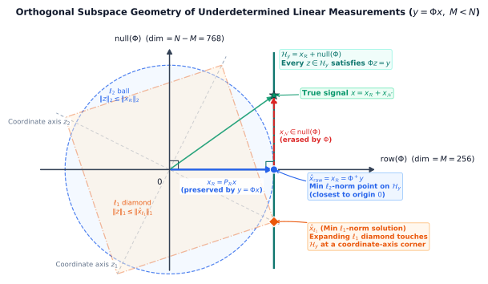
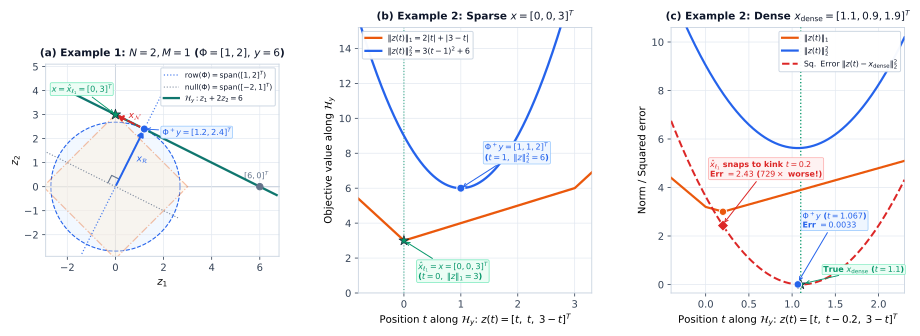

# Chapter 2: The Basic Problem — Underdetermined Linear Systems

Before examining any specific decoder, we must understand what the measurement equation $y = \Phi x$ actually tells the receiver—and what it permanently destroys.

---

## 2.1 Why $y = \Phi x$ with $M < N$ Has Infinitely Many Solutions

### Intuition
In your gradient compression pipeline, a gradient block $x \in \mathbb{R}^{1024}$ has $1024$ degrees of freedom. When the worker multiplies $x$ by $\Phi \in \mathbb{R}^{256 \times 1024}$ to obtain $y = \Phi x \in \mathbb{R}^{256}$, the receiver receives $256$ linear equations in $1024$ unknowns:
$$\begin{cases}
\phi_1^T z = y_1 \\
\phi_2^T z = y_2 \\
\;\;\vdots \\
\phi_{256}^T z = y_{256}
\end{cases}$$
Each equation $\phi_i^T z = y_i$ pins down $1$ degree of freedom (the projection of $z$ along row vector $\phi_i$). Even when all $M = 256$ rows of $\Phi$ are linearly independent (full row rank), $N - M = 1024 - 256 = 768$ degrees of freedom remain completely unconstrained.

### Statement & Derivation
**Theorem 2.1 (Structure of the Solution Set of an Underdetermined System).**
*Let $\Phi \in \mathbb{R}^{M \times N}$ with $M < N$ have full row rank $M$, and let $y = \Phi x$ be the measurement of a true signal $x \in \mathbb{R}^N$. Then the set of all candidate vectors $z \in \mathbb{R}^N$ consistent with the measurement $y$,*
$$\mathcal{H}_y = \{ z \in \mathbb{R}^N : \Phi z = y \}$$
*is an $(N - M)$-dimensional **affine subspace** (a flat hyperplane shifted away from the origin) given by:*
$$\mathcal{H}_y = x + \text{null}(\Phi) = x_{\mathcal{R}} + \text{null}(\Phi) = \{ x_{\mathcal{R}} + h : h \in \text{null}(\Phi) \}$$
*where $x_{\mathcal{R}} = P_{\mathcal{R}} x \in \text{row}(\Phi)$ is the unique row-space component of $x$.*

**Proof:**
Take any candidate vector $z \in \mathbb{R}^N$. Subtract the true signal $x$:
$$\Phi z = y \iff \Phi z = \Phi x \iff \Phi(z - x) = 0 \iff z - x \in \text{null}(\Phi)$$
Writing $h = z - x \in \text{null}(\Phi)$ gives $z = x + h$. Finally, since $x = x_{\mathcal{R}} + x_{\mathcal{N}}$ with $x_{\mathcal{N}} \in \text{null}(\Phi)$, we can absorb $x_{\mathcal{N}}$ into $h' = x_{\mathcal{N}} + h \in \text{null}(\Phi)$, showing that $\mathcal{H}_y = x_{\mathcal{R}} + \text{null}(\Phi)$. Because $\Phi$ has full row rank $M$, $\dim(\text{null}(\Phi)) = N - M \ge 1$, so $\mathcal{H}_y$ contains infinitely many vectors. $\blacksquare$

---

## 2.2 The Geometric Picture

Let us visualize the decomposition of $\mathbb{R}^N$ using the orthogonal subspaces $\text{row}(\Phi)$ and $\text{null}(\Phi)$ from Section 1.2:



Look closely at what this geometry tells us:
1. **The True Signal $x$:** Sits at some height $x_{\mathcal{N}}$ along the vertical $\text{null}(\Phi)$ axis and at horizontal position $x_{\mathcal{R}}$ along the $\text{row}(\Phi)$ axis.
2. **What the Measurement $y = \Phi x$ Reveals:** The measurement $y$ tells the decoder the **exact horizontal position $x_{\mathcal{R}}$**, and tells the decoder that the true signal $x$ lies *somewhere* on the vertical flat $\mathcal{H}_y = x_{\mathcal{R}} + \text{null}(\Phi)$.
3. **What the Measurement $y = \Phi x$ Destroys:** The vertical coordinate $x_{\mathcal{N}} \in \text{null}(\Phi)$ is completely erased. No mathematical algorithm in the universe can deduce $x_{\mathcal{N}}$ from $y$ and $\Phi$ alone without making an extra **prior assumption** about $x$:
   - **The Pseudo-Inverse Assumption (Minimum Energy):** *"I have no reason to prefer any non-zero vertical offset $h \in \text{null}(\Phi)$, so I will pick $h = 0$."* This outputs $\hat{x}_{\text{raw}} = x_{\mathcal{R}} = \Phi^+ y$, the unique point on $\mathcal{H}_y$ closest to the origin in Euclidean ($\ell_2$) distance.
   - **The $\ell_1$ Assumption (Sparsity):** *"I believe the true vector $x$ has most of its coordinates equal to zero (it lies on a coordinate axis or low-dimensional coordinate plane)."* So $\ell_1$ recovery searches up and down along $\mathcal{H}_y$ to find the point $z \in \mathcal{H}_y$ that minimizes $\|z\|_1$—which geometrically corresponds to the point where $\mathcal{H}_y$ intersects the sharpest coordinate-aligned corner of an expanding $\ell_1$ diamond.

---

## 2.3 Hand-Worked Example 1: $N = 2, M = 1$

Let us work through the smallest possible underdetermined system completely by hand so every vector can be plotted on a 2D sheet of paper.

### Setup
Suppose $N = 2$ and $M = 1$ ($r = 0.5$).
- Let the sensing matrix be:
  $$\Phi = \begin{bmatrix} 1 & 2 \end{bmatrix} \in \mathbb{R}^{1 \times 2}$$
- Suppose the true 1-sparse signal is:
  $$x = \begin{bmatrix} 0 \\ 3 \end{bmatrix}$$
- The worker encodes $x$ into a single scalar measurement:
  $$y = \Phi x = \begin{bmatrix} 1 & 2 \end{bmatrix} \begin{bmatrix} 0 \\ 3 \end{bmatrix} = 1(0) + 2(3) = 6$$

### Step 1: Find the Subspaces $\text{row}(\Phi)$, $\text{null}(\Phi)$, and Solution Set $\mathcal{H}_y$
1. **Row space $\text{row}(\Phi)$ ($1$-dimensional line through origin):**
   Span of $\Phi^T = \begin{bmatrix} 1 \\ 2 \end{bmatrix}$:
   $$\text{row}(\Phi) = \left\{ t \begin{bmatrix} 1 \\ 2 \end{bmatrix} : t \in \mathbb{R} \right\}$$
2. **Null space $\text{null}(\Phi)$ ($1$-dimensional line through origin, perpendicular to $\text{row}(\Phi)$):**
   Solve $\Phi h = h_1 + 2h_2 = 0 \implies h_1 = -2h_2$:
   $$\text{null}(\Phi) = \left\{ s \begin{bmatrix} -2 \\ 1 \end{bmatrix} : s \in \mathbb{R} \right\}$$
   Check orthogonality: $\begin{bmatrix} 1 & 2 \end{bmatrix} \begin{bmatrix} -2 \\ 1 \end{bmatrix} = -2 + 2 = 0$.
3. **Solution line $\mathcal{H}_y$:**
   All $z = [z_1, z_2]^T \in \mathbb{R}^2$ such that $z_1 + 2z_2 = 6$. We can parameterize every point on $\mathcal{H}_y$ by $z_2 = t$, so $z_1 = 6 - 2t$.

### Step 2: What Does the Pseudo-Inverse Decoder Output?
We want the point on the line $z_1 + 2z_2 = 6$ that is closest to the origin in $\ell_2$ norm— equivalently, the unique point on $\mathcal{H}_y$ that also lies in $\text{row}(\Phi)$.
Since $z \in \text{row}(\Phi) \implies z = c \begin{bmatrix} 1 \\ 2 \end{bmatrix}$, plug this into $\Phi z = 6$:
$$1(c) + 2(2c) = 5c = 6 \implies c = \frac{6}{5} = 1.2$$
Thus, the unscaled pseudo-inverse reconstruction is:
$$\hat{x}_{\text{raw}} = \Phi^+ y = \frac{6}{5}\begin{bmatrix} 1 \\ 2 \end{bmatrix} = \begin{bmatrix} 1.2 \\ 2.4 \end{bmatrix}$$
Let us also check the orthogonal decomposition $x = x_{\mathcal{R}} + x_{\mathcal{N}}$ of the true vector $x = [0, 3]^T$:
$$x = \underbrace{\begin{bmatrix} 1.2 \\ 2.4 \end{bmatrix}}_{x_{\mathcal{R}} \in \text{row}(\Phi)} + \underbrace{\begin{bmatrix} -1.2 \\ 0.6 \end{bmatrix}}_{x_{\mathcal{N}} \in \text{null}(\Phi)}$$
Check Euclidean norms:
- $\|x\|_2^2 = 0^2 + 3^2 = 9.0$.
- $\|\hat{x}_{\text{raw}}\|_2^2 = \|x_{\mathcal{R}}\|_2^2 = 1.2^2 + 2.4^2 = 1.44 + 5.76 = 7.2$.
- $\|x_{\mathcal{N}}\|_2^2 = (-1.2)^2 + 0.6^2 = 1.44 + 0.36 = 1.8$.
- Pythagoras holds: $7.2 + 1.8 = 9.0$! Notice that $\hat{x}_{\text{raw}} = [1.2, 2.4]^T$ is **dense** (both coordinates are non-zero) even though the true $x = [0, 3]^T$ was sparse.

### Step 3: What Does the $\ell_1$ Decoder (Basis Pursuit) Output?
Now let us minimize $\|z\|_1 = |z_1| + |z_2|$ along the line $z_1 + 2z_2 = 6$.
Substitute $z_1 = 6 - 2z_2$:
$$g(z_2) = \|z\|_1 = |6 - 2z_2| + |z_2|$$
This is a piecewise-linear convex function of $z_2$ with corners (kinks) where either term inside an absolute value hits zero:
- At $z_2 = 0$ (where $z$ hits the $z_1$-axis): $z = [6, 0]^T$, so $\|z\|_1 = |6| + |0| = 6$.
- At $z_2 = 3$ (where $6 - 2z_2 = 0$, i.e., $z$ hits the $z_2$-axis): $z = [0, 3]^T$, so $\|z\|_1 = |0| + |3| = 3$.
- At the pseudo-inverse solution $z = [1.2, 2.4]^T$: $\|z\|_1 = 1.2 + 2.4 = 3.6 > 3$.

Therefore, the unique global minimum of $\|z\|_1$ on $\mathcal{H}_y$ is:
$$\hat{x}_{\ell_1} = \begin{bmatrix} 0 \\ 3 \end{bmatrix} = x$$
**$\ell_1$ minimization recovered the exact 2D vector $x = [0, 3]^T$ from a single scalar measurement $y = 6$!**
*(Why did it work here? Because the line $z_1 + 2z_2 = 6$ has slope $-1/2$, which is flatter than the $\pm 1$ slopes of the edges of the $\ell_1$ diamond $|z_1| + |z_2| = 3$, forcing the diamond to touch the line at its top vertex $[0, 3]^T$.)*

---

## 2.4 Hand-Worked Example 2: $N = 3, M = 2$

Now let us step up to $N = 3$ unknowns and $M = 2$ measurements, where two measurement planes in $\mathbb{R}^3$ intersect in a 1D line.

### Setup
Let:
$$\Phi = \begin{bmatrix} 1 & 0 & 1 \\ 0 & 1 & 1 \end{bmatrix} \in \mathbb{R}^{2 \times 3}$$
Suppose the true signal is 1-sparse:
$$x = \begin{bmatrix} 0 \\ 0 \\ 3 \end{bmatrix}$$
The measurement vector is:
$$y = \Phi x = \begin{bmatrix} 1(0) + 0(0) + 1(3) \\ 0(0) + 1(0) + 1(3) \end{bmatrix} = \begin{bmatrix} 3 \\ 3 \end{bmatrix}$$

### Step 1: Parameterize the Affine Solution Space $\mathcal{H}_y$
A vector $z = [z_1, z_2, z_3]^T \in \mathbb{R}^3$ satisfies $\Phi z = y$ if and only if:
$$\begin{cases} z_1 + z_3 = 3 \implies z_1 = 3 - z_3 \\ z_2 + z_3 = 3 \implies z_2 = 3 - z_3 \end{cases}$$
Let $t = 3 - z_3 \in \mathbb{R}$ (so $z_3 = 3 - t$). Then every solution $z \in \mathcal{H}_y$ lies on the 1D line:
$$z(t) = \begin{bmatrix} t \\ t \\ 3 - t \end{bmatrix} = \begin{bmatrix} 0 \\ 0 \\ 3 \end{bmatrix} + t \begin{bmatrix} 1 \\ 1 \\ -1 \end{bmatrix}, \quad t \in \mathbb{R}$$
Here, $\text{null}(\Phi) = \text{span}\left(\begin{bmatrix} 1 & 1 & -1 \end{bmatrix}^T\right)$ has dimension $N - M = 3 - 2 = 1$. (The **span** of some vectors is the set of all their linear combinations $c_1 v_1 + \dots + c_m v_m$; here one generator gives the line $\{c\,[1,1,-1]^T : c \in \mathbb{R}\}$ through the origin.)

### Step 2: Minimum $\ell_2$-Norm (Pseudo-Inverse) Solution
We minimize $\|z(t)\|_2^2$ over $t \in \mathbb{R}$:
$$\|z(t)\|_2^2 = t^2 + t^2 + (3 - t)^2 = 3t^2 - 6t + 9 = 3(t - 1)^2 + 6$$
Setting the derivative with respect to $t$ to zero gives $6t - 6 = 0 \implies t^* = 1$.
Plugging $t^* = 1$ into $z(t)$ gives the pseudo-inverse solution:
$$\hat{x}_{\text{raw}} = \Phi^+ y = z(1) = \begin{bmatrix} 1 \\ 1 \\ 2 \end{bmatrix}, \quad \|\hat{x}_{\text{raw}}\|_2^2 = 1^2 + 1^2 + 2^2 = 6 < \|x\|_2^2 = 9$$
Notice you get the exact same result using the explicit formula $\Phi^+ = \Phi^T (\Phi \Phi^T)^{-1}$:
$$\Phi \Phi^T = \begin{bmatrix} 1 & 0 & 1 \\ 0 & 1 & 1 \end{bmatrix} \begin{bmatrix} 1 & 0 \\ 0 & 1 \\ 1 & 1 \end{bmatrix} = \begin{bmatrix} 2 & 1 \\ 1 & 2 \end{bmatrix}, \quad (\Phi \Phi^T)^{-1} = \frac{1}{3}\begin{bmatrix} 2 & -1 \\ -1 & 2 \end{bmatrix}$$
$$\Phi^+ y = \Phi^T (\Phi \Phi^T)^{-1} y = \begin{bmatrix} 1 & 0 \\ 0 & 1 \\ 1 & 1 \end{bmatrix} \left(\frac{1}{3}\begin{bmatrix} 2 & -1 \\ -1 & 2 \end{bmatrix} \begin{bmatrix} 3 \\ 3 \end{bmatrix}\right) = \begin{bmatrix} 1 & 0 \\ 0 & 1 \\ 1 & 1 \end{bmatrix} \begin{bmatrix} 1 \\ 1 \end{bmatrix} = \begin{bmatrix} 1 \\ 1 \\ 2 \end{bmatrix}$$

### Step 3: Minimum $\ell_1$-Norm (Basis Pursuit) Solution
Now minimize $\|z(t)\|_1$ over $t \in \mathbb{R}$:
$$\|z(t)\|_1 = |t| + |t| + |3 - t| = 2|t| + |3 - t|$$
By the triangle inequality, for every $t \in \mathbb{R}$:
$$2|t| + |3 - t| = |t| + \big(|t| + |3 - t|\big) \ge |t| + |t + 3 - t| = |t| + 3 \ge 3$$
with equality if and only if $t = 0$!
Plugging $t = 0$ into $z(t)$ yields:
$$\hat{x}_{\ell_1} = z(0) = \begin{bmatrix} 0 \\ 0 \\ 3 \end{bmatrix} = x$$
Once again, $\ell_1$ recovery finds the exact 1-sparse vector $[0, 0, 3]^T$, while $\Phi^+ y$ spreads the energy across all three coordinates $[1, 1, 2]^T$.

### Step 4: Now Flip the Script — What if $x$ Was Actually Dense?
Suppose the true gradient block in Example 2 was **not** sparse, but rather the dense vector:
$$x_{\text{dense}} = \begin{bmatrix} 1.1 \\ 0.9 \\ 1.9 \end{bmatrix}$$
Wait: what is its measurement $y = \Phi x_{\text{dense}}$?
$$y = \begin{bmatrix} 1.1 + 1.9 \\ 0.9 + 1.9 \end{bmatrix} = \begin{bmatrix} 3.0 \\ 2.8 \end{bmatrix} \approx \begin{bmatrix} 3 \\ 3 \end{bmatrix}$$
From $y = [3.0, 2.8]^T$:
- The **pseudo-inverse** $\Phi^+ y$ outputs $[1.067, 0.867, 1.933]^T$, which is **extremely close** to the true dense vector $[1.1, 0.9, 1.9]^T$ (squared error $\|\hat{x}_{\text{raw}} - x_{\text{dense}}\|_2^2 = \frac{1}{300} \approx 0.0033$).
- The **$\ell_1$ decoder** outputs $[0.2, 0.0, 2.8]^T$, hallucinating a sparse vector near a coordinate axis and incurring a **$729\times$ larger squared error** ($\|\hat{x}_{\ell_1} - x_{\text{dense}}\|_2^2 = 0.81 + 0.81 + 0.81 = 2.43$)!

> **The Fundamental Moral of Chapter 2:**
> $\ell_1$ recovery is not magic—it is a strong **inductive bias** toward the coordinate axes. When the true vector $x$ actually lives near a coordinate axis (sparse), $\ell_1$ wins dramatically. When the true vector $x$ points into the middle of the space (dense), forcing the solution onto a coordinate axis introduces catastrophic reconstruction error!



*Visualizing Examples 1 and 2: **(a)** In $\mathbb{R}^2$, $\Phi^+ y$ meets $\mathcal{H}_y$ perpendicularly along $\text{row}(\Phi)$ while the $\ell_1$ diamond touches the sparse corner $x = [0, 3]^T$. **(b)** Along $\mathcal{H}_y$ in $\mathbb{R}^3$, $\|z(t)\|_1$ attains its minimum at the sparse kink $t = 0$. **(c)** For a dense vector ($t = 1.1$), $\Phi^+ y$ ($t = 1.067$) stays right beside $x_{\text{dense}}$, whereas $\ell_1$ snaps to the coordinate kink $t = 0.2$ and suffers $729\times$ higher squared error.*

---

## 2.5 Empirical Verification in NumPy

Run this script to verify both hand-worked examples and see the dense vs. sparse reversal in action:

```python
import numpy as np

# Example 1: N = 2, M = 1
Phi1 = np.array([[1.0, 2.0]])
x1 = np.array([0.0, 3.0])
y1 = Phi1 @ x1
x1_pinv = np.linalg.pinv(Phi1) @ y1
print("Example 1 (N=2, M=1):")
print(f"  True x      = {x1}")
print(f"  Phi^+ y     = {x1_pinv} (||Phi^+ y||_2^2 = {np.sum(x1_pinv**2):.2f})")

# Example 2: N = 3, M = 2
Phi2 = np.array([[1.0, 0.0, 1.0],
                 [0.0, 1.0, 1.0]])
x2_sparse = np.array([0.0, 0.0, 3.0])
y2 = Phi2 @ x2_sparse
x2_pinv = np.linalg.pinv(Phi2) @ y2

# Grid search along the 1D null-space line z(t) = [t, t, 3-t] for L1 min
ts = np.linspace(-2, 4, 6001)
z_line = np.stack([ts, ts, 3.0 - ts], axis=1)
x2_l1 = z_line[np.argmin(np.sum(np.abs(z_line), axis=1))]

print("\nExample 2 (N=3, M=2) with SPARSE x:")
print(f"  True x      = {x2_sparse}")
print(f"  Phi^+ y     = {x2_pinv}")
print(f"  L1 recovery = {x2_l1}")

# Step 4: Dense x = [1.1, 0.9, 1.9]^T
x2_dense = np.array([1.1, 0.9, 1.9])
y2_d = Phi2 @ x2_dense
x2_d_pinv = np.linalg.pinv(Phi2) @ y2_d
z_line_d = np.stack([ts, ts - 0.2, 3.0 - ts], axis=1)
x2_d_l1 = z_line_d[np.argmin(np.sum(np.abs(z_line_d), axis=1))]
print("\nExample 2 (N=3, M=2) with DENSE x:")
print(f"  True x      = {x2_dense}")
print(f"  Phi^+ y     = {np.round(x2_d_pinv, 4)} (sq err = {np.sum((x2_d_pinv - x2_dense)**2):.4f})")
print(f"  L1 recovery = {np.round(x2_d_l1, 4)} (sq err = {np.sum((x2_d_l1 - x2_dense)**2):.4f})")
```

---

## 2.6 Check Your Understanding

*(Full solutions are in [Chapter 99](./99-solutions-and-references.md).)*

1. **Failure of $\ell_1$ on a Bad Sensing Matrix:** In Hand-Worked Example 1 ($N=2, M=1$ with $\Phi = [1, 2]$), we saw that $\ell_1$ minimization recovered $x = [0, 3]^T$ exactly. What happens if the true 1-sparse signal is instead $x = [6, 0]^T$ (which produces the exact same measurement $y = \Phi x = 6$)? Does $\ell_1$ minimization recover $x = [6, 0]^T$? Why is it impossible for *any* deterministic decoder to recover *every* 1-sparse vector when $M = 1$?
2. **Minimum Number of Measurements for $k$-Sparse Uniqueness:** Suppose we want every $k$-sparse vector $x \in \mathbb{R}^N$ to produce a *distinct* measurement $y = \Phi x$ (so $\Phi x^{(1)} \neq \Phi x^{(2)}$ whenever $x^{(1)} \neq x^{(2)}$ are both $k$-sparse). What is the minimum number of rows $M$ that $\Phi$ must have so that no nonzero $2k$-sparse vector $x^{(1)} - x^{(2)}$ can lie in $\text{null}(\Phi)$?
3. **Why $\hat{x}_{\text{raw}} = \Phi^+ y$ Always Has Smaller Norm Than $x$:** Prove geometrically (using Pythagoras) that for *any* true vector $x \in \mathbb{R}^N$, the unscaled pseudo-inverse decode $\hat{x}_{\text{raw}} = \Phi^+ \Phi x$ satisfies $\|\hat{x}_{\text{raw}}\|_2^2 = \|x\|_2^2 - \|\hat{x}_{\text{raw}} - x\|_2^2$.
