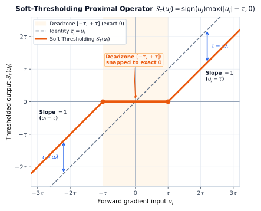
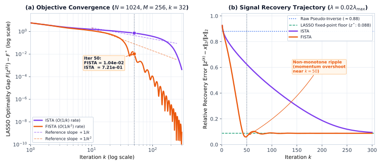

# Chapter 5: Algorithms — ISTA and FISTA

To use $\ell_1$ recovery as a gradient compression decoder, we need an algorithm that solves the unconstrained LASSO / BPDN problem:
$$\min_{z \in \mathbb{R}^N} F(z) = \underbrace{\frac{1}{2}\|\Phi z - y\|_2^2}_{f(z)} + \underbrace{\lambda \|z\|_1}_{g(z)}$$
using only fast matrix-vector multiplications ($\Phi z$ and $\Phi^T r$) that map cleanly onto GPUs. The two standard algorithms for this are **ISTA (Iterative Shrinkage-Thresholding Algorithm)** (Daubechies, Defrise, De Mol, 2004) and its momentum-accelerated successor **FISTA (Fast Iterative Shrinkage-Thresholding Algorithm)** (Beck & Teboulle, 2009).

In this chapter, we derive both algorithms from first principles, prove why soft thresholding is the exact proximal operator of the $\ell_1$ norm, analyze how to set the step size $\alpha$ and regularization $\lambda$, and compare their computational cost against the pseudo-inverse.

---

## 5.1 Deriving ISTA from the Proximal Gradient Method

### Intuition
In $F(z) = f(z) + g(z)$, the first term $f(z) = \frac{1}{2}\|\Phi z - y\|_2^2$ is smooth and convex with gradient $\nabla f(z) = \Phi^T(\Phi z - y)$ and Lipschitz constant $L = \|\Phi\|_2^2$. The second term $g(z) = \lambda \|z\|_1$ is convex, separable across coordinates, and non-differentiable at zero.

Suppose we are at iterate $z^{(t)}$. We cannot replace all of $F(z)$ by a quadratic Taylor approximation because $g(z) = \lambda \|z\|_1$ has no derivative at $z_j = 0$. Instead, we **only approximate the smooth term $f(z)$** by its isotropic quadratic upper bound (the Descent Lemma from Section 1.8) while **keeping the sharp $\ell_1$ penalty $g(z) = \lambda \|z\|_1$ exact!**

### Complete Step-by-Step Derivation
1. **Write the Quadratic Majorizer of $f(z)$ around $z^{(t)}$ with step size $\alpha \in (0, 1/L]$:**
   By the Descent Lemma (Section 1.8), for any $\alpha \le 1/L$ (so $\frac{1}{\alpha} \ge L$):
   $$f(z) \le Q_\alpha(z; z^{(t)}) := f(z^{(t)}) + \langle \nabla f(z^{(t)}), z - z^{(t)} \rangle + \frac{1}{2\alpha}\|z - z^{(t)}\|_2^2$$
2. **Add the Exact Non-Smooth Term $g(z) = \lambda \|z\|_1$ to Both Sides:**
   $$F(z) = f(z) + \lambda \|z\|_1 \le f(z^{(t)}) + \langle \nabla f(z^{(t)}), z - z^{(t)} \rangle + \frac{1}{2\alpha}\|z - z^{(t)}\|_2^2 + \lambda \|z\|_1$$
   Notice that at $z = z^{(t)}$, both sides are equal to $F(z^{(t)})$. Therefore, minimizing the right-hand side over $z \in \mathbb{R}^N$ is **guaranteed to decrease $F(z)$** at every single iteration!
3. **Complete the Square in $z$:**
   Notice that the two middle terms can be combined by completing the square:
   $$\langle \nabla f(z^{(t)}), z - z^{(t)} \rangle + \frac{1}{2\alpha}\|z - z^{(t)}\|_2^2 = \frac{1}{2\alpha}\left\| z - \big(z^{(t)} - \alpha \nabla f(z^{(t)})\big) \right\|_2^2 - \frac{\alpha}{2}\|\nabla f(z^{(t)})\|_2^2$$
4. **Drop Constants Independent of $z$ and Multiply by $\alpha > 0$:**
   Define the **forward gradient-descent step**:
   $$u^{(t)} = z^{(t)} - \alpha \nabla f(z^{(t)}) = z^{(t)} - \alpha \Phi^T(\Phi z^{(t)} - y)$$
   Then the next iterate $z^{(t+1)}$ that minimizes our upper bound is simply:
   $$z^{(t+1)} = \arg\min_{z \in \mathbb{R}^N} \left( \frac{1}{2}\left\| z - u^{(t)} \right\|_2^2 + \alpha \lambda \|z\|_1 \right) = \text{prox}_{\alpha \lambda \|\cdot\|_1}\big(u^{(t)}\big)$$

Look at how clean that is: each iteration of proximal gradient descent consists of:
1. **A standard gradient step on the smooth least-squares loss:** $u^{(t)} = z^{(t)} - \alpha \Phi^T(\Phi z^{(t)} - y)$.
2. **A proximal step on the $\ell_1$ norm:** $z^{(t+1)} = \text{prox}_{\alpha \lambda \|\cdot\|_1}(u^{(t)})$.

---

## 5.2 Deriving Soft Thresholding as the Proximal Operator of the $\ell_1$ Norm

### Intuition
How do we solve $\text{prox}_{\tau \|\cdot\|_1}(u) = \arg\min_{z \in \mathbb{R}^N} \left(\frac{1}{2}\|z - u\|_2^2 + \tau \|z\|_1\right)$ where $\tau = \alpha \lambda > 0$?
Because both $\|z - u\|_2^2 = \sum_{j=1}^N (z_j - u_j)^2$ and $\|z\|_1 = \sum_{j=1}^N |z_j|$ are sums over the individual coordinates $j = 1, \dots, N$ with **zero coupling between different coordinates**, the $N$-dimensional optimization problem splits into **$N$ completely independent 1D scalar problems**!

### Complete 1D Derivation
Fix a single coordinate $j \in \{1, \dots, N\}$. We want to find the scalar $z_j \in \mathbb{R}$ that minimizes:
$$\psi(z_j) = \frac{1}{2}(z_j - u_j)^2 + \tau |z_j|$$
Let us analyze the three cases for the sign of the optimal $z_j^*$:

1. **Case 1: Suppose $z_j^* > 0$.**
   For $z_j > 0$, $|z_j| = z_j$ is differentiable with derivative $+1$. Setting $\psi'(z_j) = 0$ gives:
   $$(z_j^* - u_j) + \tau = 0 \implies z_j^* = u_j - \tau$$
   When is this valid under our assumption $z_j^* > 0$? Precisely when $u_j - \tau > 0 \iff \mathbf{u_j > \tau}$.

2. **Case 2: Suppose $z_j^* < 0$.**
   For $z_j < 0$, $|z_j| = -z_j$ is differentiable with derivative $-1$. Setting $\psi'(z_j) = 0$ gives:
   $$(z_j^* - u_j) - \tau = 0 \implies z_j^* = u_j + \tau$$
   When is this valid under our assumption $z_j^* < 0$? Precisely when $u_j + \tau < 0 \iff \mathbf{u_j < -\tau}$.

3. **Case 3: What when $|u_j| \le \tau$ (i.e., $-\tau \le u_j \le \tau$)?**
   When $|u_j| \le \tau$, the linear slope of $(z_j - u_j)$ at $z_j = 0$ is $-u_j \in [-\tau, +\tau]$, which is **not steep enough to overcome the V-shaped corner $\tau |z_j|$** (whose left and right slopes are $-\tau$ and $+\tau$). Formally, for any $z_j \neq 0$:
   $$\psi(z_j) = \frac{1}{2}z_j^2 - u_j z_j + \tau |z_j| \ge \frac{1}{2}z_j^2 - |u_j||z_j| + \tau |z_j| = \frac{1}{2}z_j^2 + \underbrace{(\tau - |u_j|)}_{\ge 0}|z_j| > 0 = \psi(0)$$
   Therefore, whenever $|u_j| \le \tau$, the unique global minimizer is **exactly $z_j^* = 0$**!

### Combining All Three Cases: The Soft-Thresholding Operator $\mathcal{S}_\tau(u)$
Putting Cases 1, 2, and 3 together, the proximal operator of $\tau \|\cdot\|_1$ is the element-wise **soft-thresholding (shrinkage) operator** $\mathcal{S}_\tau : \mathbb{R}^N \to \mathbb{R}^N$:
$$\big[\mathcal{S}_\tau(u)\big]_j = \begin{cases}
u_j - \tau & \text{if } u_j > \tau \\
0 & \text{if } |u_j| \le \tau \\
u_j + \tau & \text{if } u_j < -\tau
\end{cases} = \text{sign}(u_j) \max\big(|u_j| - \tau, \, 0\big)$$



This reveals **two critical facts** about ISTA/FISTA:
1. **Why ISTA/FISTA produces exact zeros:** Unlike gradient descent on smooth penalties, any coordinate entering the deadzone $[-\tau, +\tau]$ is snapped to **exact floating-point zero** in a single step.
2. **Why ISTA/FISTA is a biased estimator:** Every surviving coordinate $|u_j| > \tau$ has its magnitude **shrunk toward zero by $\tau = \alpha \lambda$**.

---

## 5.3 Step Size Selection from the Lipschitz Constant $L = \|\Phi\|_2^2$

### Theory
As proved in Section 5.1, the quadratic upper bound $f(z) \le Q_\alpha(z; z^{(t)})$ holds if and only if the step size $\alpha$ satisfies:
$$0 < \alpha \le \frac{1}{L}, \qquad \text{where } L = \|\Phi^T \Phi\|_2 = \|\Phi\|_2^2 = \sigma_{\max}(\Phi)^2$$
If you choose $\alpha > \frac{2}{L}$, even the smooth gradient step $z^{(t)} - \alpha \Phi^T(\Phi z^{(t)} - y)$ diverges exponentially! The optimal theoretical step size for both ISTA and FISTA is:
$$\alpha = \frac{1}{\|\Phi\|_2^2}$$

### How to Compute $L = \|\Phi\|_2^2$ in Practice (3 Ways)
1. **Exact SVD (Offline for fixed $\Phi$):** Since $\Phi \in \mathbb{R}^{256 \times 1024}$ is fixed in your setting, compute $\sigma_{\max}(\Phi)$ once at initialization via SVD (`np.linalg.norm(Phi, ord=2)**2`).
2. **10 Steps of Power Iteration (Fast Online Method):** Starting from a random unit vector $v^{(0)} \in \mathbb{R}^N$, iterate $v^{(k+1)} = \frac{\Phi^T (\Phi v^{(k)})}{\|\Phi^T (\Phi v^{(k)})\|_2}$ for $10\text{–}15$ iterations and set $L \approx \|\Phi v^{(K)}\|_2^2$. This costs only $10$ matrix-vector products.
3. **Closed-Form Marchenko–Pastur Analytical Formula (Zero Compute!):**
   From Section 1.7, for an $M \times N$ i.i.d. Gaussian or Rademacher matrix with entry variance $\sigma^2$, the largest singular value concentrates tightly around $\sigma(\sqrt{N} + \sqrt{M})$. Thus:
   $$L = \|\Phi\|_2^2 \approx \sigma^2 \left(\sqrt{N} + \sqrt{M}\right)^2 = \sigma^2 N \left(1 + \sqrt{r}\right)^2$$
   At $N = 1024, M = 256$ ($r = 0.25$):
   - If $\sigma^2 = 1/N$: $L \approx (1 + 0.5)^2 = \mathbf{2.25}$ (with safety margin, $L \approx 2.35 \implies \alpha \approx 0.425$).
   - If $\sigma^2 = 1/M$: $L \approx \frac{1}{r}(1 + \sqrt{r})^2 = 4 \times 2.25 = \mathbf{9.0}$ ($\alpha \approx 0.11$).

---

## 5.4 ISTA vs. FISTA: Nesterov's Momentum and the $O(1/t^2)$ Rate

### Intuition: Why ISTA Is Slow ($O(1/t)$)
Writing out one step of **ISTA**:
$$z^{(t+1)} = \mathcal{S}_{\alpha \lambda}\!\left( z^{(t)} - \alpha \Phi^T(\Phi z^{(t)} - y) \right)$$
Because $\Phi^T \Phi$ has rank $M = 256 < N = 1024$, the Hessian $\nabla^2 f(z) = \Phi^T \Phi$ has $768$ zero eigenvalues! That means $f(z)$ is **not strongly convex**—it is completely flat along $\text{null}(\Phi)$ and curved along $\text{row}(\Phi)$. As a result, standard ISTA zig-zags across narrow valleys and converges in objective value at the sublinear rate $F(z^{(t)}) - F(z^*) \le O(1/t)$. To get $10^{-3}$ accuracy, $O(1/t)$ can take $1000+$ iterations.

### Statement: FISTA (Beck & Teboulle, 2009)
Beck & Teboulle (2009) showed that by applying **Nesterov's accelerated momentum extrapolation** before taking the gradient-and-shrinkage step, you can accelerate the convergence rate from $O(1/t)$ to **$O(1/t^2)$** with **almost zero extra computation per iteration** (just one vector subtraction and scalar multiply!).

**Algorithm: FISTA (Fast Iterative Shrinkage-Thresholding Algorithm)**
- **Inputs:** Sensing matrix $\Phi \in \mathbb{R}^{M \times N}$, measurement $y \in \mathbb{R}^M$, regularization $\lambda > 0$, step size $\alpha = 1 / \|\Phi\|_2^2$, threshold $\tau = \alpha \lambda$.
- **Initialize:** $z^{(0)} = \mathbf{0}_N$ (or warm start), auxiliary momentum point $w^{(1)} = z^{(0)}$, momentum scalar $t_1 = 1$.
- **For $k = 1, 2, \dots, T$:**
  1. **Gradient + Shrinkage Step (evaluated at the extrapolated point $w^{(k)}$!):**
     $$z^{(k)} = \mathcal{S}_{\alpha \lambda}\!\left( w^{(k)} - \alpha \Phi^T(\Phi w^{(k)} - y) \right)$$
  2. **Nesterov Momentum Parameter Update:**
     $$t_{k+1} = \frac{1 + \sqrt{1 + 4 t_k^2}}{2}$$
     *(Note: $t_k$ grows linearly as $t_k \approx \frac{k+1}{2}$, so the momentum coefficient $\beta_k = \frac{t_k - 1}{t_{k+1}} \approx \frac{k - 1}{k + 2}$ smoothly ramps up from $0$ toward $1$.)*
  3. **Extrapolation (Lookahead) Step:**
     $$w^{(k+1)} = z^{(k)} + \left(\frac{t_k - 1}{t_{k+1}}\right)\left(z^{(k)} - z^{(k-1)}\right)$$

### Convergence Rate Theorem (Standard Result: Beck & Teboulle, 2009, Thm 3.1 & Thm 4.4)
**Theorem 5.1 (Convergence Rates of ISTA and FISTA).**
*Let $z^*$ be any global minimizer of $F(z) = \frac{1}{2}\|\Phi z - y\|_2^2 + \lambda \|z\|_1$, and let $\alpha = 1/L$ where $L = \|\Phi\|_2^2$. Then for every iteration $k \ge 1$:*
- **For ISTA:**
  $$F(z^{(k)}) - F(z^*) \le \frac{L \|z^{(0)} - z^*\|_2^2}{2 k}$$
- **For FISTA:**
  $$F(z^{(k)}) - F(z^*) \le \frac{2 L \|z^{(0)} - z^*\|_2^2}{(k + 1)^2}$$

*What this means in numbers:* To reduce the optimality gap by a factor of $1000$, ISTA requires $k \sim 1000$ iterations, whereas FISTA requires only $k \sim \sqrt{1000} \approx 32$ iterations—a **$30\times$ speedup** at the exact same cost per iteration!

---

## 5.5 Choosing the Regularization Parameter $\lambda$, Stopping Criteria, and Warm Starts

### 1. Choosing $\lambda$: The Critical Value $\lambda_{\max} = \|\Phi^T y\|_\infty$
What happens if you choose $\lambda$ too large? The decoder outputs the **all-zero vector $\hat{x} = \mathbf{0}_N$**! Let us derive the exact threshold $\lambda_{\max}$ where this happens.

**Proposition 5.2 (Null Solution Threshold $\lambda_{\max}$).**
*The LASSO solution $\hat{x}(\lambda) = \arg\min_z \frac{1}{2}\|\Phi z - y\|_2^2 + \lambda \|z\|_1$ is identically zero ($\hat{x}(\lambda) = \mathbf{0}_N$) if and only if:*
$$\lambda \ge \lambda_{\max} := \|\Phi^T y\|_\infty = \max_{1 \le j \le N} |\phi_{\cdot, j}^T y|$$

**Proof (via one step of ISTA from $z^{(0)} = 0$):**
Start ISTA at $z^{(0)} = 0$. The first gradient is $\nabla f(0) = -\Phi^T y$, so $u^{(0)} = 0 - \alpha(-\Phi^T y) = \alpha \Phi^T y$. Applying soft-thresholding with threshold $\tau = \alpha \lambda$:
$$z^{(1)} = \mathcal{S}_{\alpha \lambda}(\alpha \Phi^T y) = 0 \iff |\alpha (\Phi^T y)_j| \le \alpha \lambda \;\;\forall j \iff \|\Phi^T y\|_\infty \le \lambda$$
Since $z^{(0)} = 0$ is a fixed point of ISTA if and only if it is a global minimizer of $F(z)$, $\hat{x}(\lambda) = 0 \iff \lambda \ge \|\Phi^T y\|_\infty$. $\blacksquare$

**Practical Rules for Setting $\lambda$ (Standard vs. Heuristic):**
- *Standard Theory (Bickel, Ritov, Tsybakov, 2009; Donoho & Johnstone, 1994):* When $y = \Phi x + e$ with $e_i \sim \mathcal{N}(0, \sigma_{\text{noise}}^2)$ and columns of $\Phi$ have unit norm, the universal threshold that suppresses Gaussian noise across $N$ coordinates with high probability is:
  $$\lambda_{\text{univ}} = \sigma_{\text{noise}} \sqrt{2 \log N}$$
- *Practical Heuristic for Gradient Compression:* Because gradient block norms $\|x\|_2$ change across layers and training steps by orders of magnitude, a fixed scalar $\lambda$ will either zero out small layers ($\lambda \ge \|\Phi^T y\|_\infty$) or fail to sparsify large layers ($\lambda \ll \|\Phi^T y\|_\infty$). Therefore, in practice $\lambda$ must be set **scale-invariantly** as a fraction of $\lambda_{\max}$:
  $$\lambda = \eta \|\Phi^T y\|_\infty \quad \text{with } \eta \in [0.01, 0.20]$$
  - Larger $\eta$ (e.g., $\eta = 0.2$) gives faster convergence in fewer FISTA iterations and sparser output, but **heavy shrinkage bias**.
  - Smaller $\eta$ (e.g., $\eta = 0.01$) approximates Basis Pursuit ($\Phi \hat{x} \approx y$) with less bias, but requires $100+$ FISTA iterations.

### 2. Stopping Criteria
In practice, three stopping criteria are used:
1. **Fixed Iteration Budget ($T = 20$ to $50$):** Best for distributed GPU training where all blocks are decoded in lockstep in a batched tensor loop without host-device synchronization (`if` branches on GPU norms stall the CUDA stream).
2. **Relative Step Change:** $\frac{\|z^{(k)} - z^{(k-1)}\|_2}{\max(\|z^{(k)}\|_2, 10^{-12})} < \epsilon_{\text{tol}}$ (typically $\epsilon_{\text{tol}} = 10^{-3}$).
3. **Subgradient Optimality Residual:** Checking how close $\Phi^T(y - \Phi z^{(k)})$ is to $\lambda \,\text{sign}(z^{(k)})$ on the active set.

### 3. Warm Starts and Homotopy Continuation
- **Across consecutive SGD steps:** Can we initialize $z^{(0)}$ at step $t$ using the decoded gradient $\hat{x}^{(t-1)}$ from step $t-1$? Only if consecutive minibatch gradients are strongly correlated. In mini-batch SGD, stochastic gradient noise often makes $\hat{x}^{(t-1)}$ a poor warm start for $\hat{x}^{(t)}$.
- **Continuation (Warm-Starting Across $\lambda$):** Solving LASSO for a sequence $\lambda_1 > \lambda_2 > \dots > \lambda_K$ (using the solution for $\lambda_{m-1}$ as the warm start for $\lambda_m$) is much faster when targeting a very small $\lambda_K$.

---

## 5.6 Cost Per Iteration vs. the Pseudo-Inverse

Let us compare the exact compute cost per gradient block ($N = 1024, M = 256$) between the **rescaled pseudo-inverse** and **$T$ iterations of FISTA**:

| Operation | Rescaled Pseudo-Inverse $\hat{x} = (\frac{N}{M}\Phi^+) y$ | FISTA ($T$ Iterations) |
| :--- | :--- | :--- |
| **Forward matvec $\Phi w^{(k)}$ ($M \times N$)** | $0$ during decode | $T$ times ($2MN$ FLOPs each) |
| **Transpose matvec $\Phi^T r^{(k)}$ ($N \times M$)** | **$1$ matvec** with $\frac{N}{M}\Phi^+$ ($2NM$ FLOPs) | $T$ times ($2NM$ FLOPs each) |
| **Vector element-wise ops ($\mathcal{S}_\tau$, momentum)** | $0$ | $T \times O(N)$ FLOPs |
| **Total Decode Cost per Block** | **$2 M N \approx 0.52\text{ MFLOPs}$** | **$4 T M N \approx 1.05 T\text{ MFLOPs}$** |
| **Relative Decode Time ($T = 50$ iterations)** | **$1\times$ (Baseline)** | **$2 T = 100\times$ slower!** |

> **Look at that ratio:**
> Every single iteration of FISTA requires **two** matrix-vector multiplications ($\Phi w^{(k)}$ of size $M \times N$, followed by $\Phi^T r^{(k)}$ of size $N \times M$), whereas the precomputed pseudo-inverse decoder $\hat{x} = (\frac{N}{M}\Phi^+) y$ requires **one** matrix-vector multiplication total!
> Thus, running FISTA for a modest $T = 50$ iterations makes decoding **$100\times$ more computationally expensive** than the pseudo-inverse decoder.

---

## 5.7 Empirical Verification in NumPy: ISTA vs. FISTA Convergence

Run this self-contained script to verify:
1. The exact threshold $\lambda_{\max} = \|\Phi^T y\|_\infty$ where the solution becomes $\mathbf{0}_N$.
2. The $O(1/k)$ vs. $O(1/k^2)$ convergence trajectories of ISTA and FISTA on a sparse recovery problem at $(N = 1024, M = 256)$.

```python
import numpy as np

rng = np.random.default_rng(42)
N, M, k = 1024, 256, 32  # k=32 is well below the Donoho-Tanner limit k_max=68

Phi = rng.normal(0.0, 1.0 / np.sqrt(M), size=(M, N))
x_true = np.zeros(N)
supp = rng.choice(N, size=k, replace=False)
x_true[supp] = rng.standard_normal(k)
y = Phi @ x_true

# 1. Verify lambda_max = ||Phi^T y||_inf
lam_max = np.max(np.abs(Phi.T @ y))
L = np.linalg.norm(Phi, ord=2) ** 2
alpha = 1.0 / L

def soft_thresh(u, tau):
    return np.sign(u) * np.maximum(np.abs(u) - tau, 0.0)

def lasso_obj(z, lam):
    return 0.5 * np.sum((Phi @ z - y) ** 2) + lam * np.sum(np.abs(z))

# Check that 1 step (and all steps) at lam = 1.01 * lam_max gives exact zero
z_test = soft_thresh(alpha * (Phi.T @ y), alpha * (1.01 * lam_max))
print(f"lambda_max = {lam_max:.4f}; ||z(1.01*lambda_max)||_1 = {np.sum(np.abs(z_test)):.2e}")

# 2. Compare ISTA vs FISTA at lam = 0.02 * lam_max
lam = 0.02 * lam_max
tau = alpha * lam
max_iters = 300

# Compute high-accuracy reference F* using 2000 FISTA steps
z_ref = np.zeros(N)
w_ref = np.zeros(N)
t_ref = 1.0
for _ in range(2000):
    z_next = soft_thresh(w_ref - alpha * (Phi.T @ (Phi @ w_ref - y)), tau)
    t_next = 0.5 * (1.0 + np.sqrt(1.0 + 4.0 * t_ref * t_ref))
    w_ref = z_next + ((t_ref - 1.0) / t_next) * (z_next - z_ref)
    z_ref, t_ref = z_next, t_next
F_star = lasso_obj(z_ref, lam)

# Run ISTA and FISTA side by side
z_ista = np.zeros(N)
z_fista = np.zeros(N)
w_fista = np.zeros(N)
t_fista = 1.0

print(f"\n{'Iter k':>8} | {'ISTA F(z)-F*':>14} | {'FISTA F(z)-F*':>14} | {'ISTA ||z-x||/||x||':>19} | {'FISTA ||z-x||/||x||':>20}")
print("-" * 86)
for it in range(1, max_iters + 1):
    # ISTA step
    z_ista = soft_thresh(z_ista - alpha * (Phi.T @ (Phi @ z_ista - y)), tau)

    # FISTA step
    z_next = soft_thresh(w_fista - alpha * (Phi.T @ (Phi @ w_fista - y)), tau)
    t_next = 0.5 * (1.0 + np.sqrt(1.0 + 4.0 * t_fista * t_fista))
    w_fista = z_next + ((t_fista - 1.0) / t_next) * (z_next - z_fista)
    z_fista, t_fista = z_next, t_next

    if it in [1, 10, 25, 50, 100, 200, 300]:
        gap_ista = max(lasso_obj(z_ista, lam) - F_star, 1e-16)
        gap_fista = max(lasso_obj(z_fista, lam) - F_star, 1e-16)
        err_ista = np.linalg.norm(z_ista - x_true) / np.linalg.norm(x_true)
        err_fista = np.linalg.norm(z_fista - x_true) / np.linalg.norm(x_true)
        print(f"{it:8d} | {gap_ista:14.4e} | {gap_fista:14.4e} | {err_ista:19.4f} | {err_fista:20.4f}")
```



*Empirical convergence at $(N = 1024, M = 256, k = 32, \lambda = 0.02\lambda_{\max})$: **(a)** FISTA achieves $O(1/k^2)$ convergence (hitting gap $1.04 \times 10^{-2}$ by iteration 50 vs. ISTA's $0.721$). **(b)** Recovery error approaches the LASSO shrinkage floor ($\approx 0.088$), exhibiting slight non-monotone momentum ripples around iteration 50 (see Question 3 below).*

---

## 5.8 Check Your Understanding

*(Full solutions are in [Chapter 99](./99-solutions-and-references.md).)*

1. **Proximal Operator of Ridge ($\ell_2^2$) Regularization:** Suppose we replace the $\ell_1$ penalty $g(z) = \lambda \|z\|_1$ with the smooth $\ell_2^2$ (Tikhonov / Ridge) penalty $g(z) = \frac{\lambda}{2}\|z\|_2^2$. Compute the proximal operator $\text{prox}_{\alpha g}(u) = \arg\min_z \left(\frac{1}{2}\|z - u\|_2^2 + \frac{\alpha \lambda}{2}\|z\|_2^2\right)$ in closed form. Why does this operator never set small non-zero coordinates to exact zero, unlike soft thresholding $\mathcal{S}_{\alpha\lambda}(u)$?
2. **Subdifferential Optimality Condition of LASSO:** Using the fact that $z^*$ is the global minimum of $F(z)$ if and only if $z^*$ is a fixed point of ISTA ($z^* = \mathcal{S}_{\alpha\lambda}(z^* + \alpha \Phi^T(y - \Phi z^*))$), prove that at the LASSO solution $z^*$, every active coordinate $j \in \text{supp}(z^*)$ satisfies $\phi_{\cdot, j}^T(y - \Phi z^*) = \lambda \,\text{sign}(z_j^*)$, and every zero coordinate $j \notin \text{supp}(z^*)$ satisfies $|\phi_{\cdot, j}^T(y - \Phi z^*)| \le \lambda$.
3. **Why Non-Monotonicity Happens in FISTA:** Looking at the FISTA output from Section 5.7 (or the momentum term $\frac{t_k - 1}{t_{k+1}}(z^{(k)} - z^{(k-1)})$), explain physically why FISTA's objective value $F(z^{(k)})$ can occasionally **increase** slightly for a few steps (overshooting the bottom of the valley like an underdamped harmonic oscillator) even though its envelope decays as $O(1/k^2)$, whereas ISTA is strictly monotone ($F(z^{(k+1)}) \le F(z^{(k)})$ at every step).
