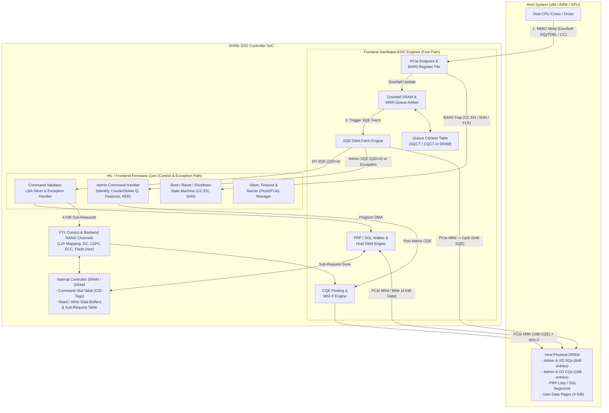

# Inside the NVMe SSD Frontend: A Firmware Engineer's Complete Tutorial

## From PCIe TLP Arrival & Hardware Queue Engines to HIL Firmware, PRP/SGL DMA, and Abort/Reset State Machines

---

## 1. The Firmware Engineer's Perspective: Where We Sit Inside the SoC

A host OS driver engineer views NVMe as a black box on the other end of a PCIe slot: they allocate queues in Host DRAM, write 64-byte commands, poke a 32-bit BAR0 doorbell register, and poll 16-byte completions.

As an **SSD Frontend / HIL Firmware Engineer**, you live on the **opposite side of the PCIe endpoint**. You write bare-metal C/C++ or RTOS firmware running on one or more embedded CPU cores inside the SSD Controller SoC (typically ARM Cortex-R5/R8/R52 or RISC-V cores with tightly coupled SRAM [TCM]), surrounded by high-speed **Hardware Automation Engines** (PCIe Endpoint, NVMe Queue Fetch Engine, PRP/SGL Parser, Host DMA Engine, and Completion Posting Engine) and downstream **FTL (Flash Translation Layer)** and **FIL (Flash Interface Layer / NAND Backend)** cores.

---

## 2. The Golden Rule of NVMe Frontend Architecture: The 333-Nanosecond Budget

Why can't Frontend Firmware just read every doorbell, fetch every command, walk every PRP list, and post every completion in C code? **Do the cycle math:**

- A PCIe Gen4 $\times 4$ enterprise/client SSD delivers **$2,000,000$ random 4 KiB Read IOPS** (and PCIe Gen5 $\times 4$ reaches **$3,000,000+$ IOPS**).
- At $3,000,000$ IOPS, one 4 KiB I/O completes every:
  $$\frac{1\text{ second}}{3,000,000\text{ IOs}} = 333.3\text{ nanoseconds}$$
- If your HIL Frontend runs on a **1.0 GHz ARM Cortex-R8 core** ($1\text{ cycle} = 1\text{ ns}$), you have a total budget of **$333$ CPU clock cycles per 4 KiB I/O**!
- A single cache miss to external controller LPDDR4 DRAM takes $\sim 80\text{–}120\text{ ns}$ ($100$ cycles). If your firmware tried to parse 64-byte SQEs, walk multi-page PRP lists, slice LBAs, and format 16-byte CQEs entirely in software on a single core, it would bottleneck at $\sim 200\text{K–}300\text{K}$ IOPS!

Therefore, every commercial NVMe controller splits the Frontend into two cooperating halves:

| Subsystem | What Lives Here | Why |
| :--- | :--- | :--- |
| **Hardware Automation Engines (The Fast Path)** | Doorbell latching, WRR Queue Arbitration, SQE DMA Fetch, Command Slot allocation, PRP/SGL List Walking, 4 KiB LBA Slicing, Host Data DMA, Sub-Request Reference Counting, CQE DMA Posting, and MSI-X generation. | Runs in parallel pipelined RTL state machines at line rate ($3\text{M+}$ IOPS) with zero FW intervention on clean 4 KiB Reads/Writes, or reduces FW work to a ~50-cycle descriptor handoff in Tightly Coupled Memory (TCM). |
| **HIL / Frontend Firmware (The Control & Exception Path)** | Controller Boot/Reset (`CC.EN`, `CSTS.RDY`), Shutdown (`CC.SHN`), **all Admin Queue (`QID=0`) commands** (`Identify`, `Create/Delete I/O SQ/CQ`, `Get/Set Features`, `AER`, `Firmware Commit`), invalid command exceptions (`PRP Offset Invalid`, `LBA Out of Range`), ordering barriers (`Flush`, `FUA`), `Abort`, and End-to-End Protection errors. | Complex state machines, rare/control-plane operations, resource allocation, and cross-core synchronization with the FTL that would be prohibitively expensive and inflexible to hardwire in RTL. |

---

## 3. Master Glossary: NVMe Spec Terms vs. Internal Firmware Terms

Throughout this tutorial, we bridge the external **NVMe Base Specification (v2.0)** terminology with the internal **SSD Controller Firmware / Hardware** terminology:

| NVMe Spec Term (External) | Controller FW / HW Term (Internal) | Size / Location | Role in the Frontend Pipeline |
| :--- | :--- | :--- | :--- |
| `BAR0` (Controller Registers) | PCIe MMIO Register File & Trap Logic | 4 KiB + Doorbells in PCIe EP | Exposes `CAP`, `CC`, `CSTS`, `AQA`, `ASQ`, `ACQ`, and Doorbells; traps writes to `CC` to interrupt HIL FW. |
| Submission Queue (`SQ`) | Host Circular Command Ring | $N \times 64\text{ B}$ in Host DRAM | Host produces 64B SQEs at `SQ_Tail`; SSD consumes at `SQ_Head`. |
| Completion Queue (`CQ`) | Host Circular Completion Ring | $N \times 16\text{ B}$ in Host DRAM | SSD produces 16B CQEs at `CQ_Tail` (with `Phase` bit); Host consumes at `CQ_Head`. |
| `SQyTDBL` / `CQyHDBL` | Doorbell SRAM Array | $4\text{ B}$ per register in BAR0 | Latches host's newest `SQ_Tail` and `CQ_Head`; updates HW Arbitration Bitmap. |
| *(Internal only)* | **Queue Context Table (`SQCT` / `CQCT`)** | $32\text{–}64\text{ B}$ per Q in Controller SRAM | Stores internal `Head`, `Tail`, `BaseAddr`, `QSize`, `Phase`, `CQID`, `Priority`, and `PRP_List` for each active queue. |
| `CID` (Command ID, 16-bit) | Host Command Tag (per-SQ) | $2\text{ B}$ in `SQE.CDW0[31:16]` | Uniquely identifies a command within one SQ; echoed back in `CQE.DW3[15:0]`. |
| *(Internal only)* | **Command Slot / `CmdTag`** | $64\text{–}128\text{ B}$ in Controller SRAM | Controller-wide unique index (e.g., `0..1023`) holding a fetched in-flight SQE, its status, and active sub-request count. |
| `PRP1`, `PRP2` / `SGL1` | Host Data Pointer (`DPTR`) | $16\text{ B}$ in `SQE[24..39]` | Describes where in Host DRAM the payload lives (page addresses or scatter-gather segments). |
| *(Internal only)* | **Internal Sub-Request (`SubReq` / `4K Slice`)** | $32\text{ B}$ in Controller SRAM | A single 4 KiB-aligned flash LBA operation (`LPN`) broken out from a multi-block NVMe command and sent to the FTL. |
| *(Internal only)* | **Buffer Descriptor (`BD`)** | $16\text{ B}$ in Controller SRAM | Points to a 4 KiB sector buffer in Controller SRAM/DRAM where DMA data is staged between PCIe and NAND. |

---

## 4. Chapter Map

Chapters build on one another; each ends with firmware design problems, solved in Chapter 99.

- **[Chapter 1: PCIe Endpoint, BAR0 Traps & The Boot/Reset State Machine](./01-pcie-and-controller-registers.md)** — How does the controller come up, reset and shut down through `CC`/`CSTS`?
- **[Chapter 2: Queue Context Tables (QCT), Doorbells & HW Fetch Engines](./02-queues-doorbells-and-arbitration.md)** — How do doorbells, queue state and arbitration drive command fetch in hardware?
- **[Chapter 3: The Firmware Control Plane — Admin Commands & I/O Queue Lifecycle](./03-admin-commands-and-queue-lifecycle.md)** — How does firmware handle Admin commands and create, delete and drain I/O queues?
- **[Chapter 4: Data Path Mechanics — SQE Parsing, PRP/SGL Walkers & DMA Engines](./04-nvm-commands-prp-sgl-and-dma.md)** — How is a command validated and its host buffers walked and sliced for the FTL?
- **[Chapter 5: Read, Write, Flush & Out-of-Order Completion Pipeline](./05-read-write-flush-and-completion-pipeline.md)** — How do reads, writes and flushes complete correctly when NAND returns data out of order?
- **[Chapter 6: What Keeps Firmware Engineers Awake — Aborts, Resets, PI & Performance](./06-error-handling-aborts-resets-and-debug.md)** — How do aborts, resets and data protection stay safe with DMAs in flight?
- **[Chapter 99: Solutions & NVMe Specification Reference](./99-solutions-and-references.md)** — Worked solutions to the firmware design problems and quick-reference tables.
