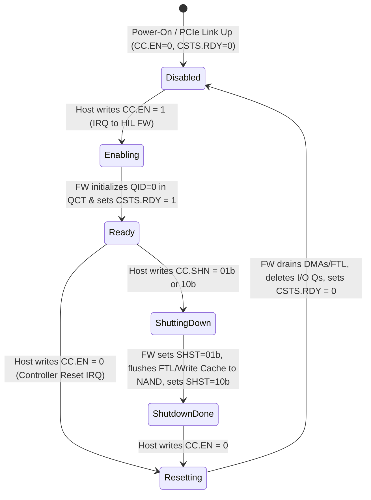

# Chapter 1: PCIe Endpoint, BAR0 Traps & The Boot/Reset State Machine

Before a single NVMe command can be fetched, your SSD's PCIe Endpoint hardware and your HIL (Host Interface Layer) Firmware must bring up the PCIe link, expose the `BAR0` register space, and execute the **Controller Initialization & Reset State Machine** (`CC.EN` $\leftrightarrow$ `CSTS.RDY`).

---

## 1.1 PCIe from the SSD Endpoint's Perspective: Posted vs. Non-Posted TLPs

### Intuition
When you write SSD firmware, you must think in **PCIe Transaction Layer Packets (TLPs)**. Every interaction between the Host and your SSD controller is one of two kinds of PCIe memory transactions:
1. **Posted Transactions (`MWr` — Memory Write):** Fire-and-forget. The sender transmits the address and data payload in a single packet; no completion packet is ever returned.
2. **Non-Posted Transactions (`MRd` — Memory Read Request $\to$ `CplD` — Completion with Data):** Split-transaction round trip. The requester sends an `MRd` TLP containing a **Requester ID**, **Tag** (e.g., 8-bit or 10-bit tag `0..255`), **64-bit Host Address**, and **Length**. Microseconds later (typically $500\text{ ns} \text{ to } 1.5\ \mu\text{s}$ across the host root complex and DRAM controller), the target returns one or more `CplD` packets carrying that Tag and the requested bytes.

### Why the SSD Is Almost Always the PCIe Bus Master
Look at who initiates which TLP in NVMe:

| Operation | Initiator | Target | PCIe TLP Type | Why NVMe Was Designed This Way |
| :--- | :--- | :--- | :--- | :--- |
| Host reads `CAP` / `CSTS` | Host CPU | SSD BAR0 | **Non-Posted `MRd` $\to$ `CplD`** | Rare (only during boot/reset/timeout). Stalls the Host CPU core for $\sim 1\ \mu\text{s}$ while waiting for `CplD`! |
| Host rings Doorbell (`SQyTDBL`) | Host CPU | SSD BAR0 | **Posted `MWr` (4 bytes)** | Fast! Host CPU drops 4 bytes into its PCIe write-combining/root buffer and continues immediately. |
| SSD fetches 64B Command (SQE) | **SSD DMA** | Host DRAM | **Non-Posted `MRd` $\to$ `CplD`** | SSD Fetch Engine pipelines dozens of `MRd` tags in parallel, hiding the $1\ \mu\text{s}$ host DRAM latency! |
| SSD reads Write Payload (Host $\to$ SSD) | **SSD DMA** | Host DRAM | **Non-Posted `MRd` $\to$ `CplD`** | SSD Host DMA Engine pulls 4 KiB pages into internal Write SRAM using parallel PCIe Read Tags. |
| SSD writes Read Payload (SSD $\to$ Host) | **SSD DMA** | Host DRAM | **Posted `MWr`** | SSD pushes 4 KiB read data to Host DRAM at full line rate via 128B/256B/512B `MWr` TLPs (`MPS`). |
| SSD posts 16B Completion (CQE) | **SSD DMA** | Host DRAM | **Posted `MWr` (16 bytes)** | Lands in Host L3 cache (via Intel DDIO / ARM coherency); Host CPU polls CQE in cache at **zero PCIe cost**! |
| SSD fires MSI-X Interrupt | **SSD DMA** | Host LAPIC | **Posted `MWr` (4 bytes)** | In PCIe, an MSI-X interrupt is literally just a 4-byte Posted Memory Write to a special host address! |

> **Firmware Engineer's Takeaway #1 (PCIe Ordering Rule):**
> Because both **Read Data (`MWr`)** and **CQE (`MWr`)** and **MSI-X (`MWr`)** are Posted Writes flowing in the same direction (SSD $\to$ Host), PCIe Producer-Consumer ordering guarantees that if your Frontend hardware issues them in the strict order:
> $$\text{1. Data } \texttt{MWr} \quad \longrightarrow \quad \text{2. CQE } \texttt{MWr} \quad \longrightarrow \quad \text{3. MSI-X } \texttt{MWr}$$
> (with Relaxed Ordering `RO=0` cleared on the CQE and MSI-X TLPs!), the Host CPU is **100% guaranteed** to see the updated 4 KiB read data in Host DRAM *before* it sees the CQE Phase bit flip, and to see the CQE *before* the MSI-X interrupt handler runs!
> **Never post a CQE from firmware before the Host DMA engine confirms the last byte of Read Data has been pushed into the PCIe TX FIFO!**

---

## 1.2 The BAR0 Controller Register Map & Hardware/Firmware Trap Architecture

When the host BIOS/OS enumerates your SSD's PCIe Function, `BAR0` (64-bit Base Address Register 0 in PCI Configuration Space) maps the NVMe Controller Registers into host physical MMIO space:

| Byte Offset | Size | Symbol | Name | Access | Handled By (HW vs. FW) |
| :--- | :--- | :--- | :--- | :--- | :--- |
| `0x0000` | 8 B | `CAP` | Controller Capabilities | RO | **HW Register** (loaded by FW at power-on reset before PCIe link training completes). |
| `0x0008` | 4 B | `VS` | Version (e.g., `0x00020000` = NVMe 2.0) | RO | **HW Register** |
| `0x000C` | 4 B | `INTMS` | Interrupt Mask Set | RW1S | **HW Interrupt Controller** |
| `0x0010` | 4 B | `INTMC` | Interrupt Mask Clear | RW1C | **HW Interrupt Controller** |
| `0x0014` | 4 B | `CC` | **Controller Configuration** | RW | **HW Register + FW Interrupt Trap!** Writing `CC.EN` or `CC.SHN` interrupts HIL FW. |
| `0x001C` | 4 B | `CSTS` | **Controller Status** | RO | **FW-Driven Register!** HIL FW sets `CSTS.RDY`, `CSTS.CFS`, and `CSTS.SHST`. |
| `0x0020` | 4 B | `NSSR` | NVM Subsystem Reset (`0x4E564D65` = `"NVMe"`) | RW | **HW + FW Trap** |
| `0x0024` | 4 B | `AQA` | Admin Queue Attributes (`ACQS`, `ASQS`) | RW | **HW Register** (read by HIL FW when `CC.EN` goes $0 \to 1$). |
| `0x0028` | 8 B | `ASQ` | Admin Submission Queue Base Address | RW | **HW Register** (must be 4 KiB aligned: bits `[11:0] == 0`). |
| `0x0030` | 8 B | `ACQ` | Admin Completion Queue Base Address | RW | **HW Register** (must be 4 KiB aligned: bits `[11:0] == 0`). |
| `0x1000 + (2y)*(4 << DSTRD)` | 4 B | `SQyTDBL` | Submission Queue `y` Tail Doorbell | RW | **HW Doorbell SRAM** (Fast path; no FW interrupt needed for I/O queues!). |
| `0x1000 + (2y+1)*(4 << DSTRD)` | 4 B | `CQyHDBL` | Completion Queue `y` Head Doorbell | RW | **HW Doorbell SRAM** |

### Bit-Level Anatomy of `CAP`, `CC`, and `CSTS`

1. **`CAP` (64-bit, Offset `0x00`):** Tells the host what your controller supports:
   - `MQES` (`Bits [15:0]`): Maximum Queue Entries Supported (**0's-based**! E.g., `0x0FFF` means $4096$ entries per I/O queue).
   - `CQR` (`Bit 16`): Contiguous Queues Required (`1` = I/O queues must be physically contiguous; `0` = controller supports non-contiguous queues via PRP lists).
   - `AMS` (`Bits [18:17]`): Arbitration Mechanism Supported (Bit 0 = Weighted Round Robin with Urgent Priority Class).
   - `TO` (`Bits [31:24]`): **Timeout** in $500\text{ ms}$ units! If you report `TO = 20` ($10\text{ seconds}$), your firmware **must** complete `CC.EN` transitions before the host's $10\text{ s}$ watchdog expires, or the host kernel declares your drive dead!
   - `DSTRD` (`Bits [35:32]`): Doorbell Stride ($2^{\text{DSTRD}} \times 4\text{ bytes}$; almost always `0`, meaning 4-byte stride).
   - `CSS` (`Bits [44:37]`): Command Sets Supported (Bit 0 = NVM Command Set).
   - `MPSMIN` (`Bits [51:48]`) & `MPSMAX` (`Bits [55:52]`): Memory Page Size $\min/\max$, where page size $= 2^{12 + \text{MPS}}$. (`MPS=0` $\implies 4\text{ KiB}$).

2. **`CC` (32-bit, Offset `0x14`):** Written by the host to configure and enable the controller:
   - `EN` (`Bit 0`): **Enable** (`0 -> 1` boots the controller; `1 -> 0` triggers a **Controller Reset**).
   - `CSS` (`Bits [6:4]`): Selected I/O Command Set (`000b` = NVM).
   - `MPS` (`Bits [10:7]`): **Host Memory Page Size** ($2^{12 + \text{CC.MPS}}$). *Crucial for Firmware:* Every `PRP` calculation inside your DMA engine depends on `HostPageSize = 4096 << CC.MPS`!
   - `AMS` (`Bits [13:11]`): Selected Arbitration Mechanism (`000b` = Round Robin, `001b` = WRR with Urgent).
   - `SHN` (`Bits [15:14]`): **Shutdown Notification** (`01b` = Normal Shutdown, `10b` = Abrupt Shutdown).
   - `IOSQES` (`Bits [19:16]`): I/O SQ Entry Size as $2^{\text{IOSQES}}$ (written as `6` $\implies 64\text{ B}$).
   - `IOCQES` (`Bits [23:20]`): I/O CQ Entry Size as $2^{\text{IOCQES}}$ (written as `4` $\implies 16\text{ B}$).

3. **`CSTS` (32-bit, Offset `0x1C`):** Driven by your HIL Firmware to report state back to the host:
   - `RDY` (`Bit 0`): **Ready** (`1` = controller is ready to process Doorbell writes; `0` = disabled/resetting).
   - `CFS` (`Bit 1`): **Controller Fatal Status** (`1` = unrecoverable FW panic / DRAM ECC error / FTL corruption).
   - `SHST` (`Bits [3:2]`): **Shutdown Status** (`00b` = Normal operation, `01b` = Shutdown in progress, `10b` = Shutdown complete).

---

## 1.3 The HIL Firmware State Machine: Enable, Controller Reset, Shutdown & FLR

### Intuition
One of the easiest ways to crash a host kernel (or corrupt host memory!) is a buggy `CC.EN` state machine in SSD firmware.
When the host driver sets `CC.EN = 0` (Controller Reset), the host is telling your SSD:
> *"Stop touching Host DRAM immediately! As soon as you clear `CSTS.RDY = 0`, I am going to free all the Host DRAM pages that held my Submission Queues, Completion Queues, PRP Lists, and Read/Write data buffers, and hand those physical pages to other processes!"*

If your firmware clears `CSTS.RDY = 0` **before** an in-flight Read DMA or CQE write has drained from your internal hardware pipelines, your SSD will DMA-write into freed host memory 10 microseconds later—causing silent memory corruption or a kernel panic on the host!

### The Four Firmware Transitions (Step-by-Step)



#### Transition 1: Cold Boot / Enable (`CC.EN: 0 -> 1`)
When the BAR0 hardware trap fires `IRQ_CC_EN_RISING` to HIL Firmware:
1. **Validate `CC` and Admin Queue Registers:**
   - Read `CC.MPS`, `CC.AMS`, `CC.IOSQES`, `CC.IOCQES`. Program the HW PRP/DMA engine with `page_shift = 12 + CC.MPS`.
   - Read `AQA` (`ASQS = AQA[11:0] + 1`, `ACQS = AQA[27:16] + 1`), `ASQ`, and `ACQ`.
2. **Program Queue Context Table (`QID = 0`) in Internal SRAM:**
   - Initialize `SQCT[0]`: `BaseAddr = ASQ`, `QSize = ASQS`, `Head = 0`, `Tail = 0`, `CQID = 0`, `Priority = Urgent`, `Valid = 1`.
   - Initialize `CQCT[0]`: `BaseAddr = ACQ`, `QSize = ACQS`, `Head = 0`, `Tail = 0`, `Phase = 1` *(initial Phase Tag is ALWAYS `1`!)*, `InterruptVector = 0`, `IntEnabled = 1`, `Valid = 1`.
   - Reset BAR0 Doorbell SRAM `SQ0TDBL = 0` and `CQ0HDBL = 0`.
3. **Enable Hardware Queue Fetch & Arbiter for `QID = 0`:**
   - Unmask the Doorbell Arbiter for `QID = 0`.
4. **Assert Ready:**
   - Write `CSTS.RDY = 1` (and ensure `CSTS.SHST = 00b`). The host driver polling `CSTS.RDY` now sees `1` and immediately submits `Identify Controller` to `SQ0`!

#### Transition 2: Controller Reset (`CC.EN: 1 -> 0`)
When the host writes `CC.EN = 0` (`IRQ_CC_EN_FALLING`):
1. **Freeze Frontend Intake Immediately:**
   - Disable the HW Doorbell Arbiter and SQE Fetch Engine so no new SQEs are fetched from Host DRAM.
   - Increment the global **Reset Epoch Counter** (`g_reset_epoch++`) in hardware/firmware so any late completions arriving from the FTL with an old epoch tag are automatically dropped.
2. **Drain In-Flight PCIe DMAs (CRITICAL!):**
   - Poll `DMA_Engine.ActiveCount == 0` and `CQE_Engine.PendingCount == 0`.
   - Wait until every outstanding PCIe `MRd` has received its `CplD` (or timed out) and every queued `MWr` has exited the PCIe Endpoint TX buffer. *(Never abort an already-issued PCIe `MRd` mid-transaction, or the returning `CplD` will trigger an Unexpected Completion AER error!)*
3. **Abort In-Flight FTL Sub-Requests & Tear Down Queues:**
   - Notify the FTL core to cancel pending reads; let committed writes in Controller DRAM finish flushing to NAND in the background (without touching Host DRAM).
   - Mark all entries in `SQCT[0..MaxQ]` and `CQCT[0..MaxQ]` as `Valid = 0`.
   - Clear all parked `Asynchronous Event Request (AER)` command slots and reset transient feature settings to defaults.
4. **Deassert Ready:**
   - Only **after** the PCIe interface is $100\%$ quiescent toward Host DRAM, write `CSTS.RDY = 0`.

#### Transition 3: Normal / Abrupt Shutdown (`CC.SHN = 01b` or `10b`)
When the host is powering down or rebooting cleanly, it leaves `CC.EN = 1` and writes `CC.SHN = 01b` (Normal) or `10b` (Abrupt):
1. HIL FW immediately sets `CSTS.SHST = 01b` (*Shutdown processing occurring*).
2. FW stops fetching I/O queues, flushes all dirty data in the volatile Write Buffer to NAND, and tells the FTL to checkpoint the L2P mapping table and journal to flash so the next boot doesn't require a slow power-loss recovery scan.
3. Once NAND is clean and metadata is checkpointed, FW sets `CSTS.SHST = 10b` (*Shutdown processing complete*).

#### Transition 4: PCIe Function Level Reset (`FLR`) or Hot Reset
Unlike `CC.EN = 0` (where the host politely waits for `CSTS.RDY = 0`), a **PCIe FLR** or **Link Down / Hot Reset** revokes Bus Master Enable (`BME = 0`) instantly in hardware!
- Your PCIe Endpoint hardware automatically gates all outbound `MRd`/`MWr` TLPs within milliseconds, resets BAR0 registers to power-on defaults (`CC = 0, CSTS = 0`), and fires a high-priority NMI/Reset interrupt to HIL FW to scrub all internal command slots and queue tables before re-enabling BAR0 responses.

---

## 1.4 Hand-Worked Register Walkthrough: Booting to Admin Queue Ready

Let us trace the exact 32-bit/64-bit register values written by a Linux `nvme` driver and responded to by our HIL Firmware on a controller with 4 KiB pages and 64-entry Admin Queues:

1. **Before Boot (`t = 0`):**
   - `CAP = 0x0020001401030FFF`:
     - `MQES = 0x0FFF` ($4096$ max entries per queue)
     - `CQR = 1`, `AMS = 01b` (WRR supported)
     - `TO = 0x14` ($20 \times 500\text{ ms} = 10\text{ s}$)
     - `DSTRD = 0` ($4\text{ B}$ doorbell stride)
     - `CSS = 0x01` (NVM Command Set)
     - `MPSMIN = 0` ($4\text{ KiB}$), `MPSMAX = 2` ($16\text{ KiB}$)
   - `CC = 0x00000000`, `CSTS = 0x00000000`.
2. **Host Allocates Admin SQ at `0x0000_0001_0000_0000` and Admin CQ at `0x0000_0001_0000_1000` (64 entries each):**
   - Host writes `AQA = 0x003F003F` (`ACQS = 63` [0's-based $\implies 64$], `ASQS = 63` [0's-based $\implies 64$]).
   - Host writes `ASQ = 0x00000001_00000000`.
   - Host writes `ACQ = 0x00000001_00001000`.
3. **Host Writes `CC = 0x00460001`:**
   - Decode `0x00460001`:
     - `IOCQES = 4` ($2^4 = 16\text{ B}$)
     - `IOSQES = 6` ($2^6 = 64\text{ B}$)
     - `SHN = 00b`, `AMS = 000b` (Round Robin), `MPS = 0` ($4\text{ KiB}$), `CSS = 000b`, **`EN = 1`**.
4. **HIL Firmware Traps `CC` Write:**
   - Parses `CC = 0x00460001`, configures `SQCT[0]` (`Size=64, Base=0x100000000`) and `CQCT[0]` (`Size=64, Base=0x100001000, Phase=1`), and writes `CSTS = 0x00000001` (`RDY = 1`).
5. **Doorbell Offset Check:**
   - With `DSTRD = 0`, `SQ0TDBL` is at `0x1000 + 2(0)*(4 << 0) = 0x1000`, and `CQ0HDBL` is at `0x1000 + (2(0)+1)*(4 << 0) = 0x1004`.

---

## 1.5 Runnable Firmware/Hardware Co-Simulation in Python

Run this self-contained script, which implements the exact BAR0 register file, bitfield decoders, and the HIL Firmware Boot / Reset / Shutdown state machine (including the in-flight DMA drain guard before clearing `CSTS.RDY`):

```python
import struct

class NVMeBAR0AndHILFirmware:
    """Cycle-accurate behavioral model of BAR0 registers and HIL Boot/Reset Firmware."""
    def __init__(self):
        # Build CAP: MQES=4095, CQR=1, AMS=1, TO=20 (10s), DSTRD=0, CSS=1, MPSMIN=0, MPSMAX=2
        self.CAP = (
            (4095 & 0xFFFF)
            | (1 << 16)          # CQR
            | (1 << 17)          # AMS = WRR
            | (20 << 24)         # TO = 20 * 500ms
            | (0 << 32)          # DSTRD = 0
            | (1 << 37)          # CSS = NVM
            | (0 << 48)          # MPSMIN = 0 (4 KiB)
            | (2 << 52)          # MPSMAX = 2 (16 KiB)
        )
        self.VS = 0x00020000     # NVMe 2.0
        self.CC = 0x00000000
        self.CSTS = 0x00000000
        self.AQA = 0x00000000
        self.ASQ = 0x0000000000000000
        self.ACQ = 0x0000000000000000

        # Internal Controller Hardware / Firmware State
        self.reset_epoch = 0
        self.in_flight_pcie_dmas = 0
        self.sqct = {}
        self.cqct = {}
        self.host_page_size = 4096

    def host_mmio_write32(self, offset: int, val: int):
        if offset == 0x14:  # CC (Controller Configuration)
            old_cc = self.CC
            self.CC = val
            self._hil_fw_on_cc_write(old_cc, val)
        elif offset == 0x24:
            self.AQA = val

    def host_mmio_write64(self, offset: int, val: int):
        if offset == 0x28:
            assert (val & 0xFFF) == 0, "ASQ must be 4KiB aligned!"
            self.ASQ = val
        elif offset == 0x30:
            assert (val & 0xFFF) == 0, "ACQ must be 4KiB aligned!"
            self.ACQ = val

    def _hil_fw_on_cc_write(self, old_cc: int, new_cc: int):
        old_en = old_cc & 0x1
        new_en = new_cc & 0x1
        new_shn = (new_cc >> 14) & 0x3

        # 1. Check Shutdown Notification (CC.SHN)
        if new_shn in (1, 2) and (self.CSTS & 0x1):
            # Set CSTS.SHST = 01b (Shutdown in progress), flush FTL, then set SHST = 10b
            self.CSTS = (self.CSTS & ~(0x3 << 2)) | (0x1 << 2)
            self._fw_flush_ftl_and_write_cache()
            self.CSTS = (self.CSTS & ~(0x3 << 2)) | (0x2 << 2)
            print(f"[HIL FW] Shutdown complete (SHN={new_shn}) -> CSTS=0x{self.CSTS:08X} (SHST=10b)")
            return

        # 2. Check Enable 0 -> 1 Transition (Cold Boot / Re-enable)
        if old_en == 0 and new_en == 1:
            mps = (new_cc >> 7) & 0xF
            iosqes = (new_cc >> 16) & 0xF
            iocqes = (new_cc >> 20) & 0xF
            self.host_page_size = 1 << (12 + mps)
            asqs = (self.AQA & 0xFFF) + 1
            acqs = ((self.AQA >> 16) & 0xFFF) + 1

            # Program Admin Queue Context (QID = 0)
            self.sqct[0] = {"base": self.ASQ, "size": asqs, "head": 0, "tail": 0, "cqid": 0, "valid": True}
            self.cqct[0] = {"base": self.ACQ, "size": acqs, "head": 0, "tail": 0, "phase": 1, "valid": True}

            # Clear SHST and set CSTS.RDY = 1
            self.CSTS = (self.CSTS & ~(0x3 << 2)) | 0x1
            print(f"[HIL FW] CC.EN 0->1: PageSize={self.host_page_size}B, SQE={1<<iosqes}B, CQE={1<<iocqes}B, "
                  f"AdminQ(ASQS={asqs}, ACQS={acqs}) -> CSTS.RDY=1")

        # 3. Check Enable 1 -> 0 Transition (Controller Reset)
        elif old_en == 1 and new_en == 0:
            self.reset_epoch += 1
            while self.in_flight_pcie_dmas > 0:
                print(f"[HIL FW] Reset draining {self.in_flight_pcie_dmas} in-flight PCIe DMAs...")
                self.in_flight_pcie_dmas -= 1
            self.sqct.clear()
            self.cqct.clear()
            self.CSTS = 0x00000000  # Clear RDY=0 and SHST=00b only AFTER DMAs drain!
            print(f"[HIL FW] CC.EN 1->0: Drained DMAs, bumped epoch={self.reset_epoch}, cleared QCT -> CSTS.RDY=0")

    def _fw_flush_ftl_and_write_cache(self):
        pass

# Simulate full lifecycle: Boot -> In-flight I/O -> Reset -> Re-enable -> Shutdown
ctrl = NVMeBAR0AndHILFirmware()
ctrl.host_mmio_write32(0x24, (63 << 16) | 63)       # AQA: 64 entries each
ctrl.host_mmio_write64(0x28, 0x00000001_00000000)   # ASQ
ctrl.host_mmio_write64(0x30, 0x00000001_00001000)   # ACQ
ctrl.host_mmio_write32(0x14, (4 << 20) | (6 << 16) | 1)  # CC: IOCQES=4, IOSQES=6, EN=1

# Simulate 2 in-flight PCIe DMAs when Host triggers a surprise Controller Reset (CC.EN=0)
ctrl.in_flight_pcie_dmas = 2
ctrl.host_mmio_write32(0x14, 0x00000000)            # CC.EN = 0

# Re-enable and perform Normal Shutdown (SHN = 01b)
ctrl.host_mmio_write32(0x14, (4 << 20) | (6 << 16) | 1)
ctrl.host_mmio_write32(0x14, (4 << 20) | (6 << 16) | (1 << 14) | 1)
```

---

## 1.6 Check Your Understanding (Firmware Design Problems)

*(Full step-by-step solutions are in [Chapter 99](./99-solutions-and-references.md).)*

1. **Doorbell Stride (`DSTRD`) Address Calculation in RTL/Firmware:** Suppose your controller hardware sets `CAP.DSTRD = 1` (so stride is $2^1 \times 4 = 8\text{ bytes}$ instead of $4\text{ bytes}$). What are the exact BAR0 byte offsets of `SQ3TDBL` (Submission Queue 3 Tail Doorbell) and `CQ3HDBL` (Completion Queue 3 Head Doorbell)? Why do some enterprise/virtualized SSD controllers set `DSTRD > 0` (e.g., `DSTRD = 10` for 4 KiB stride)?
2. **The Premature `CSTS.RDY = 0` Bug:** Suppose a junior firmware engineer writes the `CC.EN: 1 -> 0` interrupt handler so that it **first** sets `CSTS.RDY = 0` (to satisfy a tight `CAP.TO` timeout) and **then** aborts in-flight Read DMAs in a background thread. Describe the exact sequence of events on the Host OS and PCIe bus that leads to silent host memory corruption.
3. **Host Page Size (`CC.MPS`) Impact on Admin vs. I/O Queues:** If the host configures `CC.MPS = 2` ($2^{12+2} = 16\text{ KiB}$ host page size), what changes inside your controller's PRP/DMA engine, and does `CC.MPS` change the size of an SQE ($64\text{ B}$) or CQE ($16\text{ B}$)?
