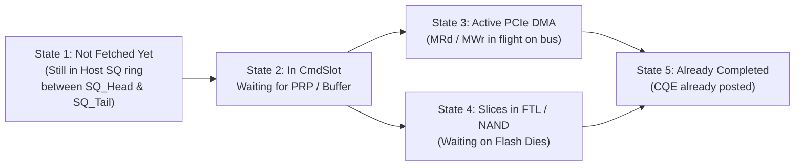

# Chapter 6: What Keeps Firmware Engineers Awake — Aborts, Resets, PI & Performance

Anyone can write SSD firmware that works on the "Sunny Day" path (clean 4 KiB reads and writes at low queue depth). What separates production-grade enterprise/client NVMe firmware from a prototype is how it survives the **"Rainy Day" corner cases**:
1. The Host sends an **`Abort` command (`Opcode 0x08`)** for a specific `(SQID, CID)` that is currently halfway through a multi-slice NAND read or PCIe DMA transfer;
2. The Host triggers a surprise **`Delete I/O SQ` or `Controller Reset (CC.EN = 0)`** while 512 commands are scattered across FTL and Backend queues (**The Stale-Tag / Epoch Problem**);
3. The Namespace is formatted with **End-to-End Data Protection (`PI` / T10 DIF)** (`8-byte` or `16-byte` metadata per block), and the Frontend must generate/verify `CRC-16` Guard, Application Tag, and Reference Tag on the fly;
4. Your SSD hits a **PCIe Read-Tag wall** or **HIL CPU cycle bottleneck** before reaching peak PCIe Gen4/Gen5 bandwidth.

In this chapter, we solve all four engineering problems in full detail.

---

## 6.1 Implementing the `Abort` Command (`Opcode 0x08`) Safely

### Intuition
When a host I/O command takes too long (or a user process is killed), the host driver submits an **Admin `Abort` command (`Opcode 0x08`)** to `SQ 0` with:
- `CDW10[15:0]` (`SQID`): The Submission Queue ID where the target command was submitted.
- `CDW10[31:16]` (`CID`): The 16-bit Command Identifier of the target command to abort.

Look at the two **strict ordering rules** mandated by the NVMe Base Specification (Section 5.1) for `Abort`:
1. **Rule 1 (Target Command CQE Must Precede Abort CQE):**
   If the target command `(SQID, CID)` is found in flight, its Completion Queue Entry (either with status **`Command Abort Requested (SCT=0x00, SC=0x07)`** if successfully aborted, or normal completion `SC=0x00` if it already finished) **MUST be posted to `CQ[CQID]` BEFORE the CQE for the Admin `Abort` command itself is posted to `CQ 0`**!
2. **Rule 2 (No DMA After Target CQE):**
   The moment the CQE for `(SQID, CID)` is posted to `CQ[CQID]`, the host OS frees the physical memory pages pointed to by `PRP1/PRP2`! Therefore, **your firmware must NEVER post `SC=0x07` while a hardware DMA engine or NAND channel is still actively writing to `PRP1/PRP2`!**

### Where Can the Target `(SQID, CID)` Be Hiding Inside the Controller?
When HIL Firmware receives `Abort(SQID, CID)`, the target command can be in one of **5 states**:



### The Production 4-Step Firmware Abort Algorithm
1. **Search the Active `CmdSlot` Table for `(sqid == SQID && cid == CID && valid == 1)`:**
   - **If NOT found in `CmdSlot`:**
     What if the command is in **State 1** (sitting in Host DRAM because `sq_head < sq_tail` hasn't fetched it yet)?
     Either:
     - Let the SQE Fetch Engine drain up to the current `sq_tail` snapshot, OR
     - Return `Abort` CQE with **`CQE.DW0[0] = 1` (*Command Not Aborted*)**! *(Spec Secret: NVMe explicitly permits the controller to complete the Admin `Abort` command with `DW0[0] = 1` if the command already completed or cannot be expediently aborted!)*
2. **If Found in `CmdSlot[tag]` — Set `CmdSlot[tag].aborted = 1` Atomically:**
   - Setting `aborted = 1` tells the FTL and Frontend Slicer: *"Do not issue any NEW PCIe host DMAs or NEW NAND operations for any remaining slices of `CmdSlot[tag]`."*
3. **Wait for `CmdSlot[tag].active_pcie_dmas == 0` and `CmdSlot[tag].remaining_subreqs == 0`:**
   - Any slice already in the FTL is fast-cancelled (or discarded into a dummy SRAM sink buffer when its NAND read finishes, **without** DMA-writing to the host's PRPs).
   - Any PCIe `MRd` already on the PCIe wire is allowed to finish draining into internal SRAM and then discarded.
4. **Post the Two CQEs in Strict Sequence:**
   - **First:** Post the I/O CQE for `(SQID, CID)` to `CQ[SQCT[SQID].cqid]` with Status **`SCT=0x00, SC=0x07` (`Command Abort Requested`)**, and wait for the CQE Posting Engine to confirm it is pushed to the PCIe TX FIFO.
   - **Second:** Post the Admin CQE for the `Abort` command to `CQ 0` with `DW0 = 0` (indicating successful abort) and `SC = 0x00`!

---

## 6.2 The Generation Counter (`Epoch Tag`) Trick: Preventing Zombie Sub-Requests

### Intuition
Suppose `CmdSlot[42]` has 8 Read slices (`SubReqs`) queued deep inside the FTL and NAND channels.
Suddenly, the host deletes the queue (`Delete I/O SQ`) or resets the controller (`CC.EN = 0 -> 1`), and **immediately submits a brand-new command that gets allocated to the exact same `CmdSlot[42]`!**
Ten microseconds later, one of the old "zombie" NAND slices from *before* the reset finishes on NAND Channel 7 and reports back to the Frontend: *"Hey, `CmdSlot[42]`, slice 3 is done!"*
If the Frontend blindly decrements `CmdSlot[42].remaining_subreqs--`, it will corrupt the **new** command's reference count and complete the new command early with garbage data!

### The Solution: 16-Bit `cmd_gen` (Generation / Epoch Counter) Per Command Slot
Every `CmdSlot[tag]` in Controller SRAM maintains a 16-bit **`gen` (generation counter)** that increments every time `CmdSlot[tag]` is allocated (or freed):
- Instead of passing a raw 10-bit `tag` (`0..1023`) to the FTL and DMA engines, the Frontend passes a **32-bit Composite Handle**:
  $$\texttt{Handle} = (\texttt{CmdSlot[tag].gen} \ll 16) \;\mid\; \texttt{tag}$$
- When a `SubReq` returns from the FTL or DMA engine carrying `Handle`, the Frontend extracts `tag = Handle & 0xFFFF` and `subreq_gen = Handle >> 16`, and checks:
  ```c
  if (!CmdSlot[tag].valid || CmdSlot[tag].gen != subreq_gen) {
      // ZOMBIE SUB-REQUEST from an aborted/reset command!
      free_sram_buffer(subreq->bd);
      return; // Silently drop! Never touch CmdSlot[tag]!
  }
  ```
This $O(1)$ generation check makes stale/zombie completions across `Abort`, `Delete SQ`, and `CC.EN` resets $100\%$ impossible!

---

## 6.3 End-to-End Data Protection (`PI` / T10 DIF) & Metadata Modes

Enterprise NVMe SSDs format namespaces with **Metadata (`MS = 8` or `64` bytes per logical block)** and **Protection Information (`PI`, Type 1/2/3)**:
1. **Two Ways Metadata Is Transferred Over PCIe (`FLBAS[4]`):**
   - **Extended LBA (Interleaved / Contiguous, `FLBAS[4] = 1`):** Each 4096B logical block is immediately followed in the same `PRP1/PRP2` buffer by its 8B metadata (`4104 bytes` per block!).
   - **Separate Metadata Buffer (`FLBAS[4] = 0`):** The 4096B data blocks are transferred via `PRP1/PRP2`, while the 8B metadata blocks are transferred to/from the separate 64-bit **`MPTR` (Metadata Pointer)** in `SQE.CDW4–5`!
2. **The 8-Byte Protection Information (`PI`) Tuple:**
   - `Guard` (`2 Bytes`): **CRC-16 (T10-DIF polynomial `0x8BB7`)** or 64-bit CRC over the 4096B data block.
   - `Application Tag` (`2 Bytes`): Checked against `SQE.CDW15.ELBAT` (masked by `ELBATM`).
   - `Reference Tag` (`4 Bytes`): Checked against `SQE.CDW14.EILBRT` (incremented by $+1$ for each subsequent logical block in the command!).
3. **Controlled by `PRINFO` (`SQE.CDW12[29:26]`):**
   - `PRINFO[3]` (`PRACT` — Protection Information Action):
     - If `PRACT == 1` (and metadata size is 8 bytes): On a **Write**, the SSD Frontend DMA Engine **auto-generates** and appends the 8-byte PI (`Guard`, `AppTag`, `RefTag`) as data streams into the Write Buffer; on a **Read**, the Frontend checks the 8-byte PI coming from NAND and **strips** it before DMA-writing the 4096B block to Host DRAM!
     - If `PRACT == 0`: Host transfers both data + 8B PI over PCIe; the SSD Frontend Hardware CRC Engine verifies `Guard` (`SC=0x82 Guard Check Error`), `AppTag` (`SC=0x83`), and `RefTag` (`SC=0x84`) inline during the DMA transfer!

---

## 6.4 Frontend Performance Math: Little's Law, PCIe Tag Starvation & CPU Cycle Budgets

As a Firmware Architect, you must know how to calculate the exact hardware resource sizes needed in your Frontend ASIC so the Frontend never bottlenecks the SSD.

### 1. Little's Law for Internal `CmdSlot` & PCIe Read-Tag Sizing
By **Little's Law** ($L = \lambda \times W$), the number of concurrent in-flight items $L$ required to sustain throughput $\lambda$ across round-trip latency $W$ is:
- **Sizing PCIe Non-Posted Read Tags (`MRd` $\to$ `CplD`) for Peak Host-to-SSD Write Bandwidth:**
  Suppose your PCIe Gen4 $\times 4$ SSD targets **$\lambda_{\text{write}} = 6.5\text{ GB/s}$** of Host $\to$ SSD Write DMA throughput, and the Host Root Complex `MRd` $\to$ `CplD` round-trip latency is **$W_{\text{PCIe}} = 1.2\ \mu\text{s}$**:
  $$\text{In-Flight Read Bytes Required} = 6.5\text{ GB/s} \times 1.2\ \mu\text{s} = 7,800\text{ Bytes}$$
  If each PCIe `MRd` requests $512\text{ bytes}$ (`MaxReadRequestSize = 512B`), you need at least $\lceil 7800 / 512 \rceil = 16$ active tags; with $128\text{ B}$ `MRd` requests (e.g., 64B SQE fetches + PRP List fetches + unaligned chunks), you need **$64 \text{ to } 256$ PCIe Tags** (which is why PCIe Gen4/Gen5 endpoints enable **10-bit Extended Tags** up to $768+$ tags!).
- **Sizing Internal `CmdSlots` and Read Buffers for Peak Random Read IOPS:**
  To sustain **$\lambda_{\text{IOPS}} = 2,000,000$ 4 KiB Read IOPS** when average NAND tR + LDPC decode latency is **$W_{\text{NAND}} = 60\ \mu\text{s}$**:
  $$\text{Concurrent In-Flight 4 KiB Reads} = 2,000,000\text{ IO/s} \times 60 \times 10^{-6}\text{ s} = \mathbf{120\text{ concurrent 4 KiB Reads}}$$
  Thus, your controller needs at least **$256\text{ to } 512$ `CmdSlots`** and **$512 \times 4\text{ KiB} = 2\text{ MiB}$ of Frontend Read/Write Buffer SRAM** to absorb NAND die contention without stalling the SQE Fetch Engine!

### 2. HIL Firmware CPU Cycle Budget Profiling
Suppose your HIL Frontend runs on a dual-core **1.2 GHz Cortex-R52** ($2.4 \times 10^9$ total cycles/sec across both cores). To hit $2,000,000$ IOPS:
$$\text{Max FW Cycles per 4 KiB I/O} = \frac{2.4 \times 10^9\text{ cycles/sec}}{2,000,000\text{ IOPS}} = \mathbf{1,200\text{ total cycles}}$$
*(That is $1,200$ cycles per I/O if each core processes half the IOPS, or $600$ cycles per core per I/O if every I/O is split 50/50 across both cores.)*
Where do those cycles go if you aren't careful?
- **Rule 1:** Keep `SQCT`, `CQCT`, `CmdSlot` table, and `SubReq` headers in **0-wait-state Tightly Coupled Memory (TCM / local SRAM)**—never in external DRAM!
- **Rule 2:** Let hardware auto-fetch the first 4 KiB PRP and auto-post normal `SC=0x00` CQEs whenever `remaining_subreqs` hits `0`, so HIL Firmware only touches a command once at dispatch ($\sim 80$ cycles) and zero times on normal completion!

---

## 6.5 Runnable Simulation: `Abort` State Machine, Generation Tags & PI CRC-16

Run this self-contained Python verification of:
1. The **Generation Counter (`cmd_gen`)** catching a zombie FTL completion after an `Abort` + slot reuse;
2. The strict **`Abort` CQE ordering** (Target I/O CQE with `SC=0x07` posted *before* Admin `Abort` CQE);
3. Inline **End-to-End Protection Information (`PI` CRC-16 + Reference Tag)** verification catching a bit-flip corruption (`SC=0x82 Guard Check Error`).

```python
import struct

def crc16_t10_dif(data: bytes) -> int:
    """Standard T10-DIF CRC-16 (polynomial 0x8BB7) used in NVMe Protection Information."""
    crc = 0x0000
    for b in data:
        crc ^= (b << 8)
        for _ in range(8):
            if crc & 0x8000:
                crc = ((crc << 1) ^ 0x8BB7) & 0xFFFF
            else:
                crc = (crc << 1) & 0xFFFF
    return crc

class ResilientFrontendSim:
    def __init__(self, num_tags=4):
        self.slots = [{"valid": False, "gen": 0, "sqid": 0, "cid": 0, "aborted": False, "rem": 0}
                      for _ in range(num_tags)]
        self.cqe_log = []  # (cqid, cid, sc, note)

    def allocate_slot(self, sqid: int, cid: int, num_slices: int):
        for tag, s in enumerate(self.slots):
            if not s["valid"]:
                s["gen"] = (s["gen"] + 1) & 0xFFFF
                s.update({"valid": True, "sqid": sqid, "cid": cid, "aborted": False, "rem": num_slices})
                handle = (s["gen"] << 16) | tag
                return tag, handle
        raise RuntimeError("No free CmdSlots!")

    def abort_command(self, target_sqid: int, target_cid: int, admin_abort_cid: int):
        for tag, s in enumerate(self.slots):
            if s["valid"] and s["sqid"] == target_sqid and s["cid"] == target_cid:
                s["aborted"] = True
                # Drain any active DMA, then free the slot and bump generation on next alloc
                s["valid"] = False
                # Rule 1: Post Target I/O CQE (SC=0x07 Command Aborted) FIRST!
                self.cqe_log.append((target_sqid, target_cid, 0x07, "Target I/O Aborted"))
                # Rule 2: Post Admin Abort CQE (DW0=0, SC=0x00) SECOND!
                self.cqe_log.append((0, admin_abort_cid, 0x00, "Admin Abort Success (DW0=0)"))
                return
        # Not found -> Complete Admin Abort with DW0=1 (Not Aborted)
        self.cqe_log.append((0, admin_abort_cid, 0x00, "Admin Abort Not Found (DW0=1)"))

    def on_ftl_subreq_return(self, handle: int):
        tag = handle & 0xFFFF
        gen = (handle >> 16) & 0xFFFF
        s = self.slots[tag]
        if not s["valid"] or s["gen"] != gen:
            print(f"[Zombie Guard] Dropped stale SubReq for tag={tag} (subreq_gen={gen} != current_gen={s['gen']})!")
            return
        s["rem"] -= 1
        if s["rem"] == 0:
            s["valid"] = False
            self.cqe_log.append((s["sqid"], s["cid"], 0x00, "Normal I/O Completion"))

    def verify_pi_type1(self, block_4k: bytes, pi_8b: bytes, expected_lba: int) -> int:
        guard, app_tag, ref_tag = struct.unpack(">HHI", pi_8b)
        if app_tag == 0xFFFF:
            return 0x00  # Escape tag disables PI check
        calc_crc = crc16_t10_dif(block_4k)
        if guard != calc_crc:
            return 0x82  # SC=0x82: End-to-End Guard Check Error
        if ref_tag != (expected_lba & 0xFFFFFFFF):
            return 0x84  # SC=0x84: End-to-End Reference Tag Check Error
        return 0x00

sim = ResilientFrontendSim()

# 1. Allocate slot 0 for (SQ1, CID=500), get composite handle with gen=1
tag0, zombie_handle = sim.allocate_slot(sqid=1, cid=500, num_slices=2)
print(f"Allocated tag={tag0} for CID=500 -> Handle=0x{zombie_handle:08X} (gen={zombie_handle>>16})")

# 2. Host aborts (SQ1, CID=500) via Admin CID=99
sim.abort_command(target_sqid=1, target_cid=500, admin_abort_cid=99)

# 3. Slot 0 is immediately reused by a NEW command (SQ1, CID=501) -> gets gen=2!
tag0_new, valid_handle = sim.allocate_slot(sqid=1, cid=501, num_slices=1)
print(f"Re-allocated tag={tag0_new} for CID=501 -> Handle=0x{valid_handle:08X} (gen={valid_handle>>16})")

# 4. Now the old zombie SubReq from CID=500 returns from NAND, followed by the valid SubReq for CID=501
sim.on_ftl_subreq_return(zombie_handle)
sim.on_ftl_subreq_return(valid_handle)

print("\nCQE Posting Order Log:")
for cqid, cid, sc, note in sim.cqe_log:
    print(f"  CQ={cqid} | CID={cid:3d} | SC=0x{sc:02X} | {note}")

# 5. Test T10-DIF PI Verification (Valid block vs 1-bit flip)
payload = b"A" * 4096
pi_tuple = struct.pack(">HHI", crc16_t10_dif(payload), 0x1234, 1000)
print(f"\nPI Check (Valid Data, LBA=1000):   SC=0x{sim.verify_pi_type1(payload, pi_tuple, 1000):02X}")
corrupted = b"B" + payload[1:]
print(f"PI Check (1-Byte Flip, LBA=1000):  SC=0x{sim.verify_pi_type1(corrupted, pi_tuple, 1000):02X} (Expected 0x82=Guard Error)")
print(f"PI Check (Wrong LBA=1001):         SC=0x{sim.verify_pi_type1(payload, pi_tuple, 1001):02X} (Expected 0x84=RefTag Error)")
```

---

## 6.6 Check Your Understanding (Firmware Design Problems)

*(Full step-by-step solutions are in [Chapter 99](./99-solutions-and-references.md).)*

1. **`Abort` Command Limit (`ACL`) in `Identify Controller`:** Byte 258 of `Identify Controller` reports `ACL` (Abort Command Limit, 0's-based, e.g., `ACL = 3` means $4$ concurrent `Abort` commands). What must HIL Firmware do if the host submits a 5th concurrent `Abort` command while 4 earlier `Abort` commands are still draining in-flight DMAs?
2. **Fused Operations (`FUSE = 01b` + `10b`, e.g., `Compare and Write`):** In NVMe, an atomic `Compare and Write` is sent as two adjacent SQEs in the same Submission Queue: SQE #1 has `FUSE = 01b` (`Compare`) and SQE #2 has `FUSE = 10b` (`Write` to the exact same `SLBA` and `NLB`). What must the Frontend Command Parser do if:
   - (a) The two commands do not have the same `SLBA`/`NLB`, or another non-fused command is submitted right after `FUSE = 01b`?
   - (b) The first command (`Compare`) fails with `Compare Failure (SCT=0x02, SC=0x85)`? What status code must be returned for the second command (`Write`)?
3. **Calculating PCIe Payload Efficiency (`MPS = 128B` vs. `MPS = 512B`):** Every PCIe Memory Write (`MWr`) TLP carries a $16\text{ B}$ to $24\text{ B}$ TLP/Data-Link/Physical framing overhead (say $20\text{ B}$ total overhead per TLP). When transferring a 4 KiB ($4096\text{ B}$) read page from SSD to Host, how many `MWr` TLPs are sent if PCIe Max Payload Size (`MPS`) is $128\text{ B}$ vs. $512\text{ B}$, and what is the wire efficiency in each case?
